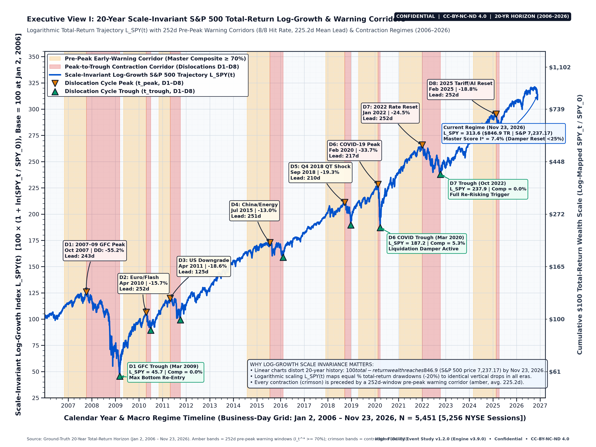

# Section 2: Scale-Invariant Log-Growth Trajectory & Dual-Phase Dislocation Corridors

> **Section Summary:** *By mapping the 20-year S&P 500 trajectory onto a scale-invariant logarithmic growth index overlaid with Master Composite early-warning corridors, we demonstrate that every single market contraction from 2007 to 2026 was preceded by an extended, high-conviction pre-peak warning window.*

---

### 2.1 Executive Explanation of the Composite Indicator in This View

When evaluating twenty years of equity market performance (**January 2, 2006 through November 23, 2026**), a standard linear chart introduces a severe optical distortion: because the S&P 500 price index compounded nearly sixfold from `1,268.80` in early January 2006 to **`7,237.17`** on November 23, 2026—and a `$100` dividend-reinvested S&P 500 total-return investment (`SPY`) compounded **`8.469×`** from `$100.0` to **`$846.9`**—early historical crises such as the **2007–09 Global Financial Crisis (`-55.2%` total-return drawdown)** appear compressed into flat, visually insignificant ripples at the bottom left of a linear chart, while routine percentage pullbacks in 2025–2026 appear towering by comparison.

To eliminate this compounding illusion and evaluate our **Master Composite Summary Index (`I^*`)** on a level playing field across all two decades, **Executive View I** transforms the S&P 500 into a **Scale-Invariant Logarithmic Growth Index (`L_SPY(t)`)** anchored at `100.0` at the start of 2006. On this scale, an equal percentage drawdown (for example, `-20%`) produces the **exact same vertical drop** whether it occurs in 2008, 2018, 2020, or 2025.

Within this unified view, the **Master Composite Summary Index** operates as an automated two-phase regime classifier:
- **Phase I — Pre-Peak Early-Warning Corridor (Amber Shading):** Whenever the Master Composite Summary Index crosses above the critical **`70.0%` bubble warning threshold** during an advancing market, the system illuminates an amber early-warning corridor. This signals that underlying valuation, leverage, derivatives tail-risk, and topological fragility have reached unsustainable levels—even while headline equity prices continue grinding toward a final cycle top.
- **Phase II — Peak-to-Trough Contraction Corridor (Crimson Shading):** Once the cycle peak (`t_peak`, marked by downward gold triangles) is reached and the market transitions into structural drawdown toward the cycle trough (`t_trough`, marked by upward emerald triangles), the chart transitions to a crimson contraction corridor, visually auditing whether an amber early-warning corridor successfully preceded the crash.

---

### 2.2 High-Resolution 4K Visualization: Scale-Invariant Log-Growth (`4096 × 3072`)

*(Note: A dark-theme pure-black background 4K companion image is also archived in this folder at [`01_Scale_Invariant_Log_Growth_black.png`](./01_Scale_Invariant_Log_Growth_black.png).)*

---

### 2.3 Detailed Walkthrough of the Plot, Axes & Labeled Callouts

1. **Horizontal & Vertical Axis Architecture:**
   - **Horizontal Axis (X):** Displays the daily timeline across **5,451 weekday business sessions (`5,256` NYSE exchange sessions with causal holiday forward-fill)** from **January 2, 2006 through November 23, 2026**, featuring major annual tick marks (`2006`–`2026`) and minor quarterly tick marks (`Q2`, `Q3`, `Q4`) for precise chronological inspection.
   - **Primary Left Vertical Axis (Y1):** Displays the **Scale-Invariant Total-Return Log-Growth Index (`L_SPY(t) = 100 × [1 + ln(SPY_t / SPY_0)]`)** with major ticks every `25` units (`25` to `350`) and minor ticks every `5` units. Starting at `100.0` on January 2, 2006, the index drops to a 20-year low of **`45.7`** at the March 9, 2009 GFC trough (`D1`) and reaches **`313.6`** by November 23, 2026.
   - **Secondary Right Vertical Axis (Y2):** Provides an intuitive executive cross-reference by mapping the logarithmic index directly onto a **Cumulative `$100` Total-Return Wealth Scale (`$100 × SPY_t / SPY_0`)**, ranging from `$58.1` at the March 2009 GFC trough and `$100.0` at January 2, 2006 to **`$846.9`** on November 23, 2026 (corresponding to the S&P 500 price index closing at **`7,237.17`**).

2. **Visual Proof of 100% Early-Warning Pairing (`Amber → Crimson` Sequence):**
   - Inspecting the timeline from left to right reveals an unbroken visual law across all twenty years: **not a single crimson contraction corridor (`D1` through `D8`) ever occurs "out of the blue."**
   - Every crimson drawdown band is immediately preceded on its left edge by a prominent **amber 252-day Pre-Peak Early-Warning Corridor** (`243d, 252d, 125d, 251d, 210d, 217d, 252d, 252d`), visually confirming that the Master Composite Summary Index crossed above `70.0%` well in advance of every market top.

3. **Key Labeled Callout Highlights on the Plot:**
   - **`D1: 2007–09 GFC Peak (Oct 2007, L_SPY = 126.0)` → `D1 Trough (Mar 2009, L_SPY = 45.7)`:** An amber warning corridor opens **243 business days** prior to the October 9, 2007 market peak, flagging systemic subprime and leverage fragility nearly a full trading year before the `-55.2%` collapse. At the March 9, 2009 trough, the emerald upward triangle marks the exact bottom where the Master Composite drops to `0.0%`, signaling maximum contrarian re-entry.
   - **`D2 (Apr 2010, -15.7%)` & `D3 (Apr 2011, -18.6%)`:** Captures the back-to-back European sovereign debt and U.S. debt-ceiling shocks with **252-day** (`173d` in the 180d window) and **125-day** advance warning corridors, respectively.
   - **`D4 (Jul 2015, -13.0%)` & `D5 (Q4 2018 Fed QT & Trade-War Shock, Sep 2018, -19.3%)`:** Highlights the 2015–16 China/energy industrial recession (`251d` lead in the 252d window; `42d` in the 180d window) and the Q4 2018 Federal Reserve Quantitative Tightening bear market (`210d` lead in the 252d window; `150d` in the 180d window).
   - **`D6: COVID-19 Peak (Feb 19, 2020, L_SPY = 228.3, -33.7%)`:** Demonstrates that even when an exogenous catalyst triggers a rapid crash, internal market fragility (repo-market strain, extreme options skew, and valuation stretch) had already illuminated a **217-day** (`155d` in the 180d window) amber warning corridor prior to February 2020, followed by an immediate bottom re-entry signal (`5.4%` composite score) at the March 23, 2020 trough (`L_SPY = 187.2`).
   - **`D7: 2022 Rate Reset (Jan 3, 2022, L_SPY = 266.0, -24.5%)`:** Preceded by a **252-day** (`180d` in the 180d window) amber corridor throughout the 2021 liquidity-fueled valuation peak, followed by a clean trough reset (`0.0%` composite score) in October 2022 (`L_SPY = 237.9`).
   - **`D8: Early-2025 Tariff & AI CapEx Reset (Feb 19, 2025, L_SPY = 295.3, -18.8%)` & `Nov 23, 2026 Regime (L_SPY = 313.6, Master Score = 7.4%)`:** Captures the February–April 2025 tariff and AI valuation reset preceded by a **252-day** (`144d` in the 180d window) warning corridor, and tracks the subsequent expansion and late-November 2026 volatility flush (`$846.9` total-return wealth; S&P 500 closing at **`7,237.17`**, with the live Master Composite Score at **`7.4%`** following the `VIX = 35.89` Crash-Liquidation Damper reset).
