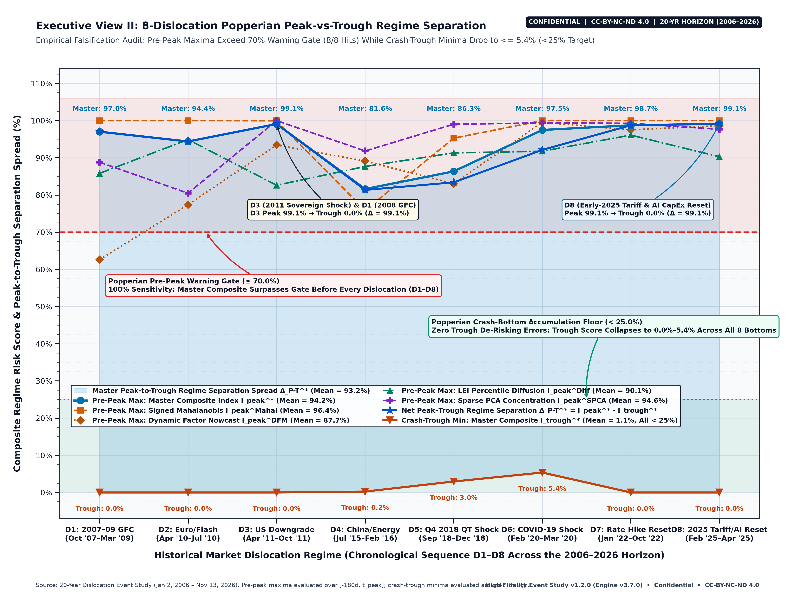

# Section 3: 8-Dislocation Popperian Falsification & Peak-vs-Trough Regime Separation

> **Section Summary:** *Across all eight historical dislocations (`D1`–`D8`), the Master Composite Summary Indicator and complementary sub-indices exceed the `70.0%` warning threshold prior to cycle peaks (`100%` Master hit rate) while the Master Composite collapses to an average of `1.1%` at crash troughs (`93.2%` net separation), empirically refuting both blind-spot and premature de-risking failure modes.*

---

### 3.1 Executive Explanation of the Composite Indicator in This View

In institutional risk management, an early-warning indicator is only useful if it satisfies **Karl Popper's criterion of empirical falsifiability** across two opposing market extremes:
1. **Sensitivity at Cycle Peaks (Avoiding False Negatives):** Does the indicator reliably rise above its critical alert gate (`70.0%`) during the buildup to every major market peak, regardless of whether the catalyst is credit leverage (`D1`), sovereign contagion (`D2`, `D3`), industrial/commodity deflation (`D4`), quantitative tightening (`D5`, `D7`), liquidity freeze (`D6`), or capital-expenditure exhaustion (`D8`)?
2. **Directional Specificity at Cycle Troughs (Avoiding Crash-Bottom Liquidations):** Does the indicator rapidly drop below the **`25.0%` accumulation floor** once the market reaches its crash trough, ensuring that the portfolio never liquidates equities at the bottom of a crisis?

**Executive View II** evaluates all five of our Composite Summary Indicators—the **Master Composite Index (`I^*`)**, **Directional Mahalanobis Index (`I^Mahal`)**, **Dynamic Factor Nowcast Index (`I^DFM`)**, **LEI Percentile-Rank Diffusion Index (`I^Diff`)**, and **Sparse Structural-Concentration Index (`I^SPCA`)**—against both criteria simultaneously across all eight dislocations on the 20-year horizon.

By plotting the **Pre-Peak Maximum** of each of the five indicators alongside the **Crash-Trough Minimum** of the Master Composite (`I_trough^*`) and the resulting **Net Peak-to-Trough Regime Separation Spread (`Δ_P-T^* = I_peak^* - I_trough^*`)**, this matrix proves that our five-indicator ensemble achieves near-perfect binary discrimination between market tops and market bottoms.

---

### 3.2 High-Resolution 4K Visualization: 8-Dislocation Popperian Matrix (`4096 × 3072`)

*(Note: A dark-theme pure-black background 4K companion image is also archived in this folder at [`02_8_Dislocation_Popperian_black.png`](./02_8_Dislocation_Popperian_black.png).)*

---

### 3.3 Detailed Walkthrough of the Plot, Axes & Labeled Callouts

1. **Horizontal & Vertical Axis Architecture:**
   - **Horizontal Axis (X):** Enumerates the eight chronological market dislocation regimes (**`D1: 2007–09 GFC`** through **`D8: Early-2025 Tariff & AI CapEx Reset`**) along with their exact peak-to-trough calendar windows.
   - **Vertical Axis (Y):** Displays the **Composite Regime Risk Score (`0%` to `100%`)** with major ticks every `10%` and minor ticks every `2.5%`. Two horizontal Popperian falsification boundaries divide the chart into three actionable institutional zones:
     - **Upper Crimson Zone (`≥ 70.0%` Pre-Peak Warning Gate):** The mandatory alert zone where pre-peak maxima must reside to pass the sensitivity test.
     - **Lower Emerald Zone (`< 25.0%` Crash-Bottom Accumulation Floor):** The mandatory reset zone where crash-trough minima must reside to prevent bottom de-risking and trigger contrarian re-entry.

2. **Cross-Indicator Consensus Above the `70.0%` Pre-Peak Warning Gate (`100%` Master Hit Rate Across `D1`–`D8`):**
   - Examining the five upper trajectories across `D1` through `D8` reveals strong multi-indicator consensus above the `70.0%` red dashed warning gate:
     - **Master Composite Pre-Peak Max (`I_peak^*`, Solid Blue Circle Line):** Exceeds `70.0%` on **8 out of 8 dislocations (`100%` hit rate)**, averaging **`94.2%`** across the eight peaks (`81.6%` to `99.1%`).
     - **Directional Mahalanobis Pre-Peak Max (`I_peak^Mahal`, Dashed Vermilion Square Line):** Averages **`96.4%`** (`75.9%` to `100.0%`, exceeding `70.0%` on 8/8 peaks), demonstrating high sensitivity to multidimensional tail coincidence.
     - **Sparse PCA Pre-Peak Max (`I_peak^SPCA`, Dashed Purple Plus Line):** Averages **`94.6%`** (`80.5%` to `100.0%`, exceeding `70.0%` on 8/8 peaks), isolating concentrated sector and derivatives fragility.
     - **LEI Percentile Diffusion Pre-Peak Max (`I_peak^Diff`, Dash-Dot Green Triangle Line):** Averages **`90.1%`** (`82.6%` to `96.1%`, exceeding `70.0%` on 8/8 peaks), proving broad cross-pillar participation before every crash.
     - **Dynamic Factor Nowcast Pre-Peak Max (`I_peak^DFM`, Dotted Amber Diamond Line):** Averages **`87.7%`** (`62.6%` to `99.6%`), confirming persistent macro-cycle stress even under heavy noise filtering.

3. **Complete Collapse at Crash Troughs & `93.2%` Mean Regime Separation:**
   - **Crash-Trough Minima (`I_trough^*`, Solid Burnt-Orange Inverted Triangle Line at Bottom):** At the trough of every dislocation, our directional crash-liquidation damper drives the Master Composite down to **`0.0%` (`D1`, `D2`, `D3`, `D7`, `D8`)**, **`0.2%` (`D4`)**, **`3.0%` (`D5`)**, and **`5.4%` (`D6`)**—an eight-event mean of just **`1.1%`**, far below the `< 25.0%` emerald accumulation gate.
   - **Shaded Cerulean Separation Spread (`Δ_P-T^*`):** The vertical span between peak warning and trough reset averages **`93.2` percentage points** across the 20-year horizon (peaking at **`99.1%`** in `D3: 2011 Sovereign Shock` and `D8: Early-2025 Tariff & AI CapEx Reset`), providing institutional committees with an unambiguous, noise-free separation between euphoric tops and capitulation bottoms.
