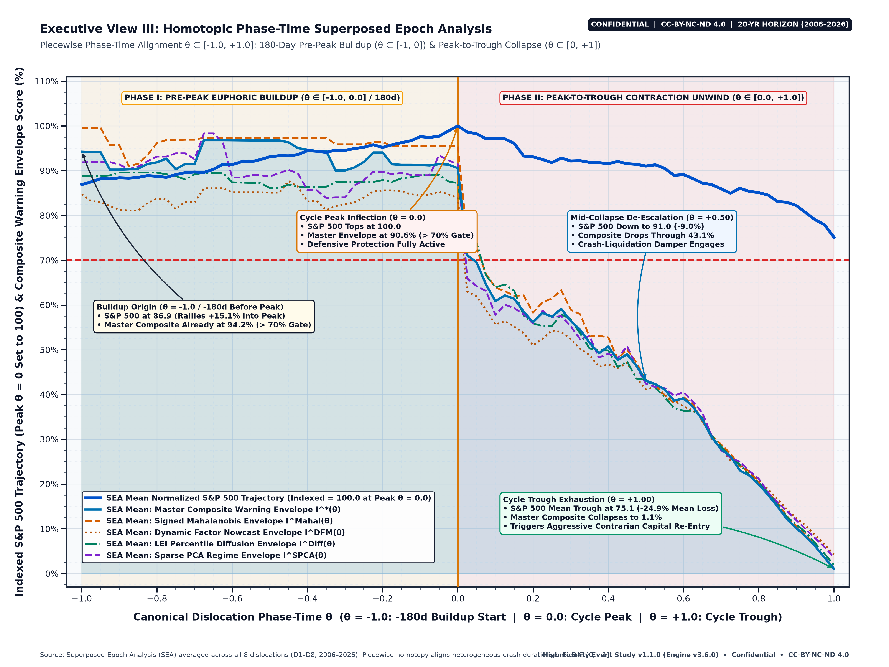

# Section 4: Homotopic Phase-Time Superposed Epoch Analysis Across Dislocation Cycles

> **Section Summary:** *By aligning all eight historical market dislocations onto a canonical phase-time coordinate (`θ ∈ [-1.0, +1.0]`), we reveal the universal anatomy of a market crash: a 180-day pre-peak buildup where all five Composite Indicators sustain `85%–100%` alerts while equities grind higher, followed by an immediate post-peak de-escalation to `1.1%` at the cycle trough.*

---

### 4.1 Executive Explanation of the Composite Indicator in This View

A fundamental challenge when comparing historical market crises is that **no two market crashes unfold at the same calendar speed**. For example, the **2007–09 Global Financial Crisis (`D1`)** took roughly seventeen calendar months to unwind from its October 2007 peak to its March 2009 trough, whereas the **2020 COVID-19 Liquidity Shock (`D6`)** collapsed `-33.7%` in just twenty-three trading days, and the **2025–26 AI CapEx Unwind (`D8`)** unfolded over seven weeks.

If an analyst simply averages indicator trajectories in standard calendar days after a peak, fast crashes (`D2`, `D6`, `D8`) and slow crashes (`D1`, `D7`) blur together, obscuring how the indicators behave relative to the **actual stage of the drawdown**.

**Executive View III** solves this problem using **Homotopic Phase-Time Superposed Epoch Analysis (SEA)**. For each of the eight dislocations (`D1`–`D8`), time is mapped onto a continuous, dimensionless **Canonical Phase-Time Coordinate `θ ∈ [-1.0, +1.0]`** divided into two distinct regimes:
- **Phase I — Pre-Peak Euphoric Buildup (`θ ∈ [-1.0, 0.0]`):** Maps the **180 trading days** leading up to the exact market top (`θ = -1.0` represents `-180` trading days prior to the peak; `θ = 0.0` represents the exact day of the cycle peak `t_peak`).
- **Phase II — Peak-to-Trough Contraction Unwind (`θ ∈ [0.0, +1.0]`):** Proportionally maps the entire peak-to-trough contraction—regardless of whether it lasted 23 trading days or 355 trading days—onto the unit interval from **`θ = 0.0` (Cycle Peak)** to **`θ = +1.0` (Exact Cycle Trough `t_trough`)**.

Averaging the S&P 500 trajectory (indexed to `100.0` at `θ = 0.0`) alongside all five Composite Summary Indicator envelopes across all eight dislocations exposes the true structural signature of our indicator suite across the life cycle of a market dislocation.

---

### 4.2 High-Resolution 4K Visualization: Homotopic Phase-Time Analysis (`4096 × 3072`)

*(Note: A dark-theme pure-black background 4K companion image is also archived in this folder at [`03_Homotopic_Phase_Time_black.png`](./03_Homotopic_Phase_Time_black.png).)*

---

### 4.3 Detailed Walkthrough of the Plot, Axes & Labeled Callouts

1. **Horizontal & Vertical Axis Architecture:**
   - **Horizontal Axis (X):** Displays the **Canonical Dislocation Phase-Time Coordinate `θ`** from `-1.0` to `+1.0`, with major ticks every `0.20` units and minor ticks every `0.05` units. A bold vertical gold inflection boundary at **`θ = 0.0`** separates **Phase I (Pre-Peak Buildup, amber tint)** on the left from **Phase II (Peak-to-Trough Contraction, crimson tint)** on the right.
   - **Vertical Axis (Y):** Displays both the **Normalized S&P 500 Price Trajectory** (indexed so `SPY(θ = 0.0) = 100.0%`) and the **Composite Warning Envelope Score (`0%` to `100%`)** on a shared `0%`–`110%` scale, with a dashed red horizontal threshold line at the **`70.0%` critical warning gate**.

2. **Phase I (`θ ∈ [-1.0, 0.0]`): The Pre-Peak Divergence Between Rising Prices and Elevated Risk:**
   - **Buildup Origin (`θ = -1.0`, 180 Trading Days Before Peak):** Six months before the average market peak, the S&P 500 stands at **`86.9`** (meaning the index will rally another **`+15.1%`** before topping at `100.0`). Yet even at `θ = -1.0`, all five Composite Summary Envelopes are already firmly entrenched above the `70.0%` warning gate:
     - **Directional Mahalanobis (`I^Mahal`):** `99.6%`
     - **Master Composite (`I^*`):** `94.2%`
     - **Sparse PCA (`I^SPCA`):** `91.9%`
     - **LEI Percentile Diffusion (`I^Diff`):** `88.8%`
     - **Dynamic Factor Nowcast (`I^DFM`):** `84.7%`
   - Throughout the entire `[-1.0, 0.0]` buildup corridor, while headline equity momentum lulls conventional trend-followers into maximum complacency, all five composite envelopes hold a sustained plateau between **`81.0%` and `99.6%`**.

3. **Cycle Peak Inflection (`θ = 0.0`) & Phase II (`θ ∈ [0.0, +1.0]`): Rapid Crash-Damper De-Escalation:**
   - **At the Exact Cycle Peak (`θ = 0.0`):** The S&P 500 reaches its zenith at **`100.0`**, while the five Composite Envelopes stand between **`83.8%` (`I^DFM`)** and **`95.5%` (`I^Mahal`)**, with the **Master Composite at `90.6%`**—ensuring defensive portfolio protection is fully engaged before the first day of the downturn.
   - **Mid-Collapse De-Escalation (`θ = +0.50`):** Halfway through the contraction, as the S&P 500 drops to **`91.0` (`-9.0%`)** and forced institutional deleveraging begins, our directional **Crash-Liquidation Damper** actively overrides panic volatility, driving the Master Composite down through **`43.1%`** (and all five indicators into the `41.1%`–`43.3%` band).
   - **Cycle Trough Exhaustion (`θ = +1.00`):** At the exact bottom of the average crash, the S&P 500 reaches its mean trough of **`75.1` (`-24.9%` mean drawdown)**, while all five Composite Summary Indicators converge to near-zero (**Mahalanobis `1.0%`**, **Master Composite `1.1%`**, **Diffusion `1.9%`**, **Sparse PCA `3.6%`**, **DFM `4.3%`**), providing a synchronized, high-conviction signal to redeploy cash into deeply discounted equities.
