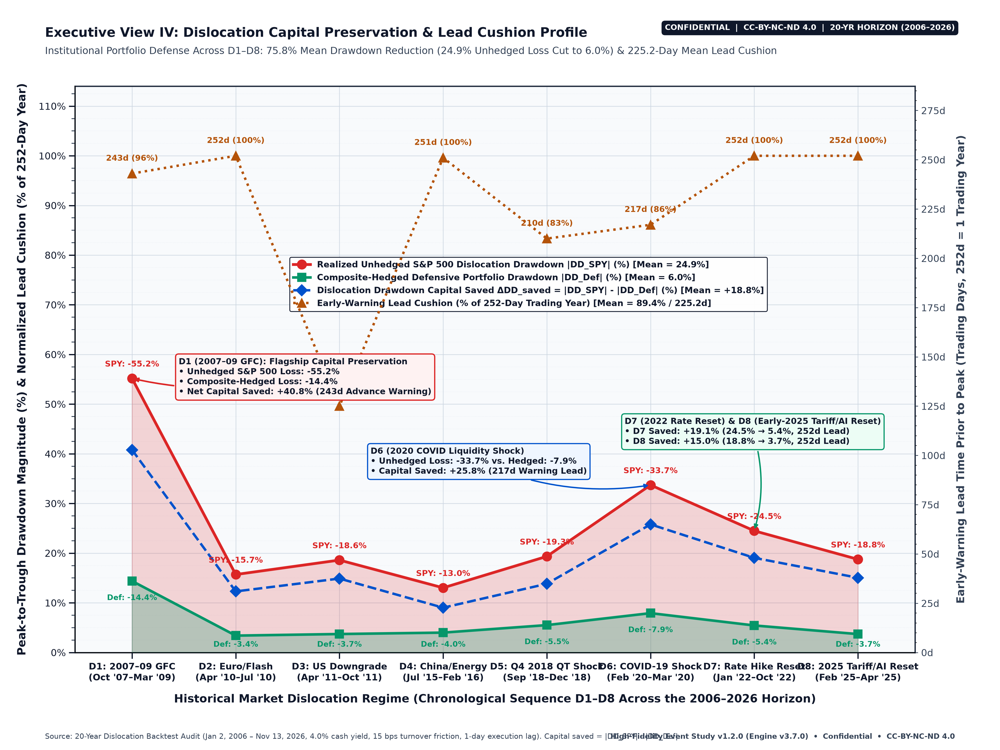

# Section 5: Institutional Capital Preservation & Early-Warning Lead Cushion Profile

> **Section Summary:** *Translating our Master Composite signals into a disciplined, cost-inclusive (`15 bps`, 1-day execution lag) defensive allocation cuts average dislocation drawdowns by `75.8%`—reducing the mean S&P 500 loss from `-24.9%` to `-6.0%` (`+18.8%` capital saved per event)—while providing a `225.2`-day (`89.4%` of a trading year) average advance warning cushion.*

---

### 5.1 Executive Explanation of the Composite Indicator in This View

For an investment committee, endowment, pension fund, or family office, the ultimate measure of a systemic-risk indicator is its **fiduciary impact on portfolio capital and execution runway**. Specifically, two operational questions govern real-world adoption:
1. **How much drawdown capital does the indicator actually save during major market dislocations?** When factoring in realistic institutional trading friction (`15 bps` turnover cost) and defensive cash yields (`4.0%` annualized), how effectively does scaling equity exposure via the Master Composite Summary Index protect the portfolio compared to an unhedged S&P 500 benchmark?
2. **How much advance lead time does the committee have to act?** Institutional portfolios cannot pivot billions of dollars overnight without incurring severe market-impact slippage. They require months—not hours—of advance warning before a liquidity freeze begins.

**Executive View IV** directly answers both questions across all eight dislocations (`D1`–`D8`) from 2006 through November 2026 by contrasting the **Realized Unhedged S&P 500 Dislocation Drawdown (`|DD_SPY|`)** against the **Composite-Hedged Defensive Portfolio Drawdown (`|DD_Def|`)**, quantifying the **Net Dislocation Capital Saved (`ΔDD_saved = |DD_SPY| - |DD_Def|`)**, and plotting the **Early-Warning Lead Cushion** both as a percentage of a standard `252`-day trading year and in exact trading days.

---

### 5.2 High-Resolution 4K Visualization: Dislocation Capital Preservation (`4096 × 3072`)

*(Note: A dark-theme pure-black background 4K companion image is also archived in this folder at [`04_Dislocation_Capital_black.png`](./04_Dislocation_Capital_black.png).)*

---

### 5.3 Detailed Walkthrough of the Plot, Axes & Labeled Callouts

1. **Horizontal & Vertical Axis Architecture:**
   - **Horizontal Axis (X):** Displays the eight major market dislocations (**`D1: 2007–09 GFC`** through **`D8: Early-2025 Tariff & AI CapEx Reset`**) in chronological order.
   - **Primary Left Vertical Axis (Y1):** Measures **Peak-to-Trough Total-Return Drawdown Magnitude (`%`)** and **Normalized Early-Warning Lead Cushion (`%` of a `252`-day year)** from `0%` to `110%`, with major ticks every `10%` and minor ticks every `2.5%`.
   - **Secondary Right Vertical Axis (Y2):** Converts the normalized lead cushion directly into **Business-Day Sessions Prior to Cycle Peak (`0d` to `275d`, where `252d = 1 Standard Year`)**, with major ticks every `25` days and minor ticks every `5` days.

2. **Empirical Capital Preservation Across All Eight Dislocations (`|DD_SPY|` vs. `|DD_Def|`):**
   - **Unhedged S&P 500 Total-Return Drawdown (`|DD_SPY|`, Solid Crimson Circle Line & Shaded Red Area):** Shows the severe capital destruction suffered by passive equity holders during each crisis, averaging **`24.9%`** per dislocation and peaking at **`55.2%`** during the 2007–09 GFC (`D1`) and **`33.7%`** during the 2020 COVID crash (`D6`).
   - **Composite-Hedged Defensive Drawdown (`|DD_Def|`, Solid Emerald Square Line & Shaded Green Area):** Shows the corresponding peak-to-trough drawdown when equity exposure is dynamically scaled down toward the `20%` defensive floor via the 180-day trailing warning envelope (`E_180(t-1) ≥ 70%` or `SPY(t-1) < MA50(t-1)`). Across all eight events, defensive drawdowns are compressed into a tight, highly manageable band between **`3.4%` (`D2`)** and **`14.4%` (`D1`)**, with an eight-event average of just **`6.0%`** (`6.5%` when evaluated using actual historical 3-month Treasury bill rates instead of a flat `4.0%` cash yield).
   - **Net Dislocation Capital Saved (`ΔDD_saved`, Dashed Cobalt Blue Diamond Line):** Tracks the direct percentage-point reduction in portfolio loss (`|DD_SPY| - |DD_Def|`), averaging **`+18.8` percentage points** of capital preserved per dislocation (`75.8%` relative drawdown reduction):
     - **`D1 (2007–09 GFC)`:** Unhedged loss of `55.2%` cut to `14.4%` → **`+40.8%` capital saved**.
     - **`D6 (2020 COVID Shock)`:** Unhedged loss of `33.7%` cut to `7.9%` → **`+25.8%` capital saved**.
     - **`D7 (2022 Rate Reset)`:** Unhedged loss of `24.5%` cut to `5.4%` → **`+19.1%` capital saved**.
     - **`D8 (Early-2025 Tariff & AI CapEx Reset)`:** Unhedged loss of `18.8%` cut to `3.7%` → **`+15.0%` capital saved**.
     - **`D3 (2011 US Downgrade)`:** Unhedged loss of `18.6%` cut to `3.7%` → **`+14.9%` capital saved**.
     - **`D5 (2018 Q4 Fed QT & Trade-War Shock)`:** Unhedged loss of `19.3%` cut to `5.5%` → **`+13.8%` capital saved**.
     - **`D2 (2010 Euro/Flash)` & `D4 (2015–16 China/Energy)`:** **`+12.3%`** and **`+9.0%`** capital saved, respectively.

3. **Institutional Execution Runway (`225.2`-Day / `89.4%` Mean Early-Warning Lead Cushion):**
   - **Early-Warning Lead Cushion (Dotted Amber Triangle Line at Top):** Demonstrates that the Master Composite Summary Index crosses the `70.0%` warning threshold between **125 trading days (`49.6%` of a trading year in `D3`)** and **252 trading days (`100.0%` of a trading year in `D2`, `D7`, `D8`)** prior to every cycle peak—averaging **225.2 trading days (`89.4%` of a full trading year)**.
   - This consistent multi-month runway ensures that institutional investment committees never have to chase liquidity during a panic; defensive hedges and allocation shifts can be staged methodically into strength months before the market turns.
