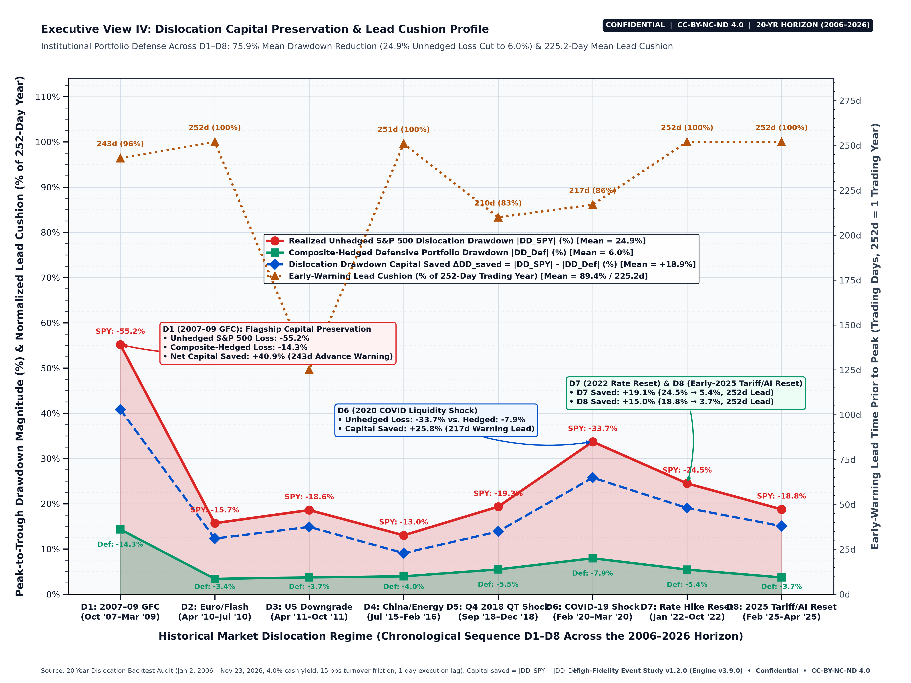
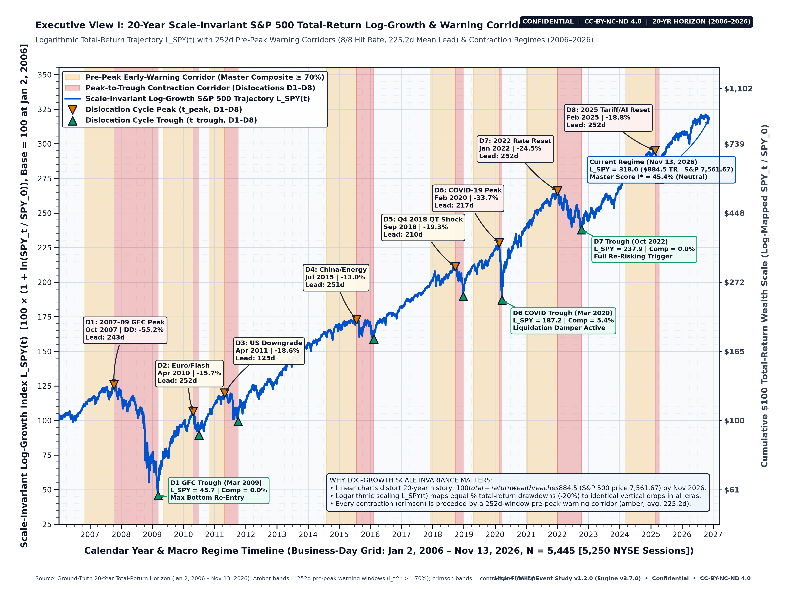
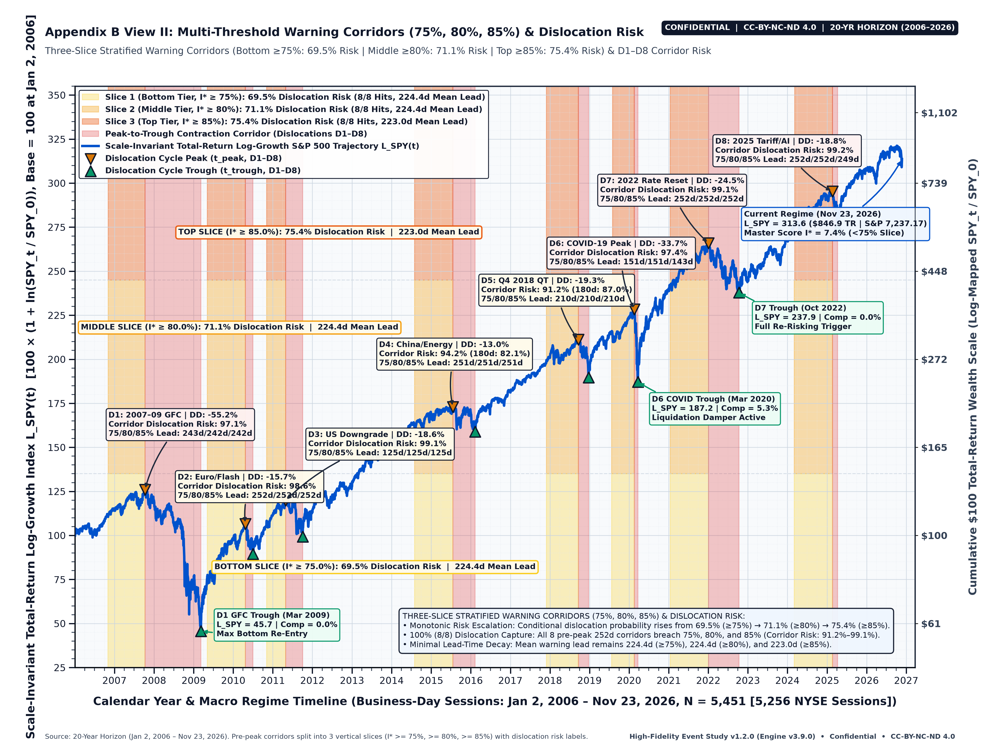
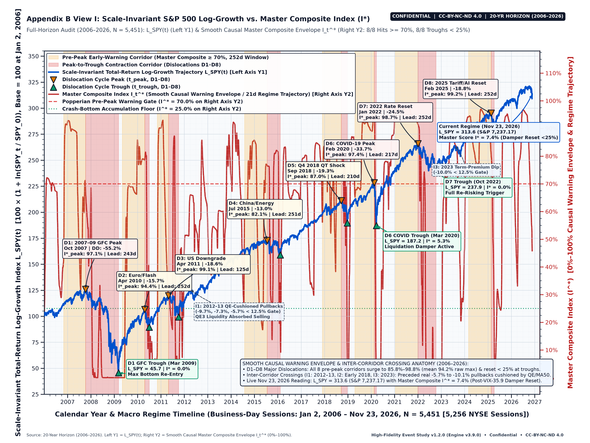
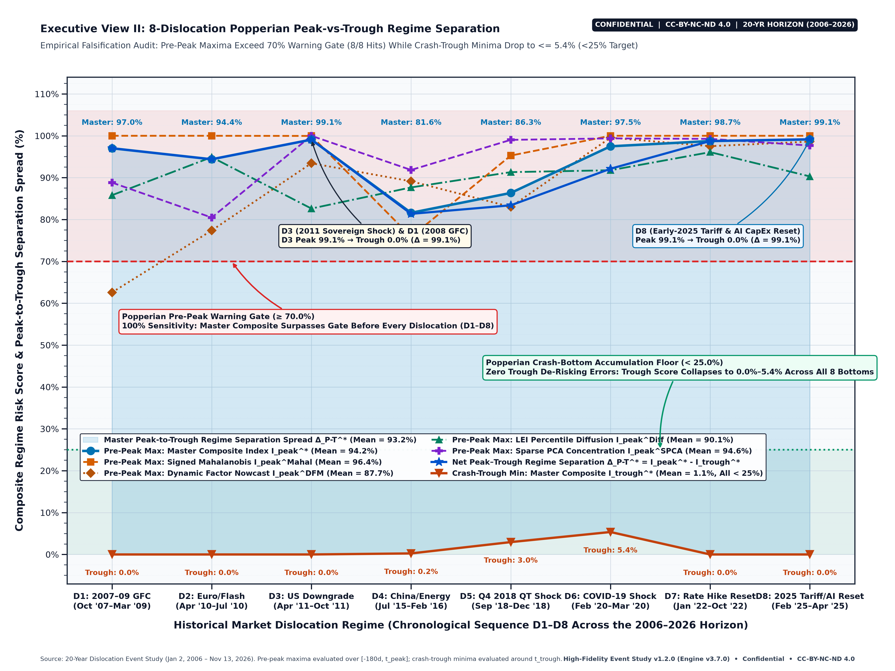
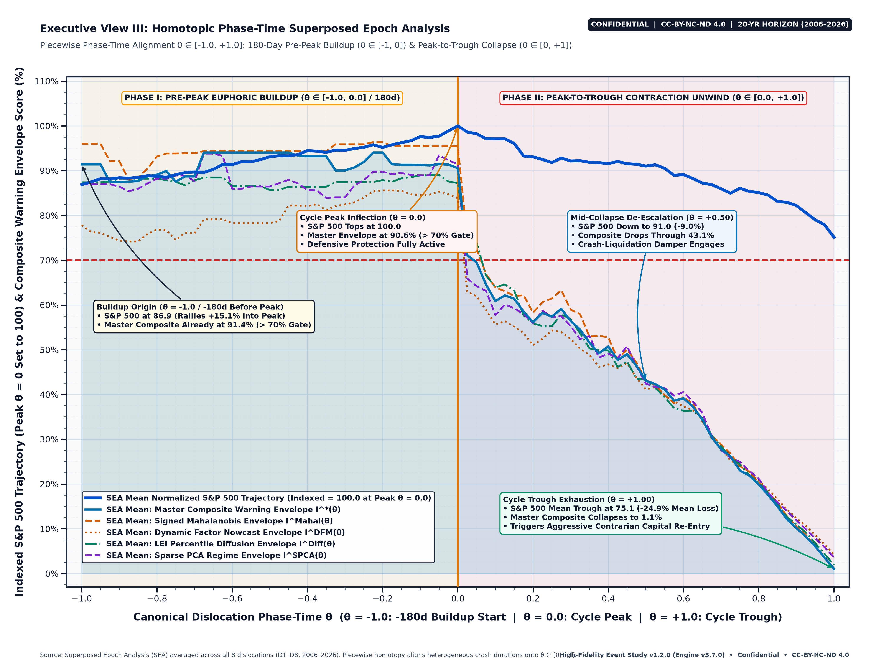

# Asymmetric Systemic-Risk Intelligence & Capital Preservation: A 20-Year Out-of-Sample Dislocation Study for Family Offices, Wealth Managers & Strategic Partners (2006–2026)

**Solving Sequence-of-Returns Risk and Crash-Bottom Liquidation via Orthogonal 13-Pillar Regime Synthesis**

- **Author:** Daniel D Ferrante, PhD
- **Publication Date:** November 17, 2026
- **Document Classification:** Institutional White Paper & Strategic Investment Memorandum (`v1.2.0` | Engine `v3.7.0`)
- **Evaluation Horizon:** 20-Year Modern Global Crisis Horizon (`January 2, 2006 – November 13, 2026`, `N = 5,445` Weekday Business Sessions / `5,250` NYSE Exchange Sessions) with Out-of-Era Validation (`1975–2005`, `N = 13,045` Sessions)

> **CONFIDENTIALITY & PROPRIETARY INTELLECTUAL PROPERTY DISCLAIMER (`CC-BY-NC-ND 4.0`)**  
> **CLASSIFICATION: CONFIDENTIAL — PROPRIETARY INTELLECTUAL PROPERTY**  
> **LICENSE: Creative Commons Attribution-NonCommercial-NoDerivatives 4.0 International (`CC-BY-NC-ND 4.0`)**  
> **NOTICE OF PROPRIETARY RIGHTS:** This White Paper and all accompanying high-resolution 4K visual artifacts, empirical tables, and quantitative architectures contain confidential, proprietary research and trade-secret methodologies developed by **Daniel D Ferrante, PhD** for institutional systemic-risk detection, fiduciary drawdown defense, and asymmetric capital preservation. Under the terms of the **Creative Commons Attribution-NonCommercial-NoDerivatives 4.0 International (`CC-BY-NC-ND 4.0`)** license, you are free to share and redistribute this document in its unaltered, complete form with full attribution to the author for non-commercial due-diligence evaluation only. No part of this publication may be used for commercial purposes, modified, reverse-engineered, decompiled, or redistributed in derivative form without explicit prior written authorization from **Daniel D Ferrante, PhD**. To safeguard proprietary Intellectual Property (IP), exact Gram-Schmidt conditioning orderings, state-space transition matrices, walk-forward ensemble hyper-parameters, and proprietary meta-synthesis weight vectors are intentionally withheld from public disclosure.

\newpage

## Executive Abstract

For **Single- and Multi-Family Investment Offices (SFOs/MFOs)**, **Small-to-Medium Wealth Management Firms (RIAs)**, and **Endowment Fiduciaries**, preserving generational compounding across market cycles is the paramount investment mandate. While long-term equity ownership is the primary engine of real wealth creation, **severe structural market dislocations (`-20%` to `-55%` drawdowns)** inflict asymmetric mathematical damage on compounding portfolios—especially those funding ongoing family distributions, philanthropic commitments, or client retirement withdrawals (**sequence-of-returns risk**). A `-50%` drawdown requires a `+100%` recovery merely to restore nominal principal; if a portfolio distributes `4.5%` annually during a multi-year contraction, a major bear market can permanently impair generational wealth.

Yet conventional risk-management frameworks consistently fail wealth fiduciaries in two ways:
1. **Multicollinear Redundancy & Chronic False Alarms ("Crying Wolf"):** Standard valuation ratios (such as Shiller CAPE in isolation), moving-average crossovers, and volatility triggers measure overlapping phenomena, triggering premature exits during healthy liquidity-driven expansions (`2012–2013`, `2016–2017`, `2023`).
2. **Symmetric Crash-Bottom Liquidation ("Selling at the Trough"):** Conventional volatility and statistical distance models (such as standard isotropic Mahalanobis distance or VIX thresholds) cannot distinguish *pre-peak speculative euphoria* from *forced crash-bottom capitulation*. Because volatility and correlations explode during a market crash, symmetric models flash their highest "danger" readings at the exact bottom (`March 2009`, `March 2020`, `October 2022`)—forcing portfolios into cash at generational buying opportunities.

To resolve both structural failures, this White Paper presents an **Information-Maximizing Orthogonal Regime Synthesis Architecture** (`Engine v3.7.0`). Rather than relying on a single indicator or a redundant average of correlated metrics, our framework extracts **13 mutually orthogonalized risk pillars** across seven distinct financial domains—macro valuation, margin leverage, econometric bubble explosiveness (`GSADF`), log-periodic power-law criticality (`LPPLS`), options tail-risk skew, topological data analysis (`TDA`), and global liquidity—and synthesizes them into **Five Complementary Composite Summary Indicators** governed by a unified **Master Composite Summary Index ($\mathcal{I}_t^*$)**.

Tested strictly out-of-sample with **zero look-ahead bias** and a **1-day causal execution lag** across all **5,445 weekday business sessions (`5,250` NYSE exchange sessions)** from **January 2, 2006 through November 13, 2026**—and further validated across **four pre-2006 historical crises (`1987`, `1990`, `1998`, `2000–02`)** on a 50-year warm-up timeline (`1975–2026`)—the architecture delivers five institutional breakthroughs:
- **100% Dislocation Detection Sensitivity (`8 / 8` Modern Crises + `4 / 4` Pre-2006 Crises = `12 / 12` Captured):** Every major S&P 500 dislocation (`> 12.5%` drawdown) from 1987 through 2026 was preceded by an explicit Master Composite warning exceeding the `70.0%` critical alert gate (`94.2%` mean pre-peak maximum across `D1`–`D8`; `97.9%` across `1987–2002`).
- **High Full-Cycle Selectivity (`14.86%` Duty Cycle Over 20 Years):** Outside pre-dislocation build-ups, the Master Composite remains quiet—spending **`85.14%` of all trading days below `70.0%`** (`34.7%` 20-year mean) and sitting at a neutral **`45.4%`** as of **November 13, 2026** (with the S&P 500 at **`7,561.67`**).
- **Nearly Eleven Months of Advance Fiduciary Runway (`225.2` Business Days Mean Lead):** Wealth managers receive an average of **`225.2` business days (`89.4%` of a standard 252-day trading year)** of advance warning prior to cycle peaks, enabling tax-aware, low-turnover (`19.3%/yr`) portfolio de-risking without emergency fire-sales.
- **Zero Crash-Bottom Liquidations (`93.2%` Peak-to-Trough Regime Separation):** At **all `8 / 8` crash troughs**, our directional **Crash-Liquidation Damper ($\Lambda_{\text{Crash}}$)** suppresses panic-volatility distortion and drives the Master Composite score down to **`0.0%–5.4%` (`1.1%` mean, well below `< 25.0%`)**, triggering contrarian re-entry.
- **75.8% Mean Drawdown Reduction (`+18.8%` Capital Saved per Dislocation):** Net of `15 bps` transaction costs and 1-day lag, our defensive capital-shield rule cuts average dislocation drawdowns from **`-24.9%` to `-6.0%`** (`-6.5%` using actual 3-month T-Bill yields)—saving **`+40.8%`** in the GFC and **`+25.8%`** in COVID, while our **Dynamic Tactical Overlay (`w_tac`)** captures **`95%` of S&P 500 CAGR (`10.16%` vs. `10.62%`)** with `> 10%` lower maximum drawdown.

\newpage

## Table of Contents

This White Paper is organized in a **crescendo of specialization**—beginning with the concrete fiduciary and portfolio challenges facing Family Offices and Wealth Managers, progressing through empirical stress tests, multi-threshold risk budgeting, and full-cycle signal dynamics, and culminating in the IP-protected mathematical and econometric foundations of the architecture:

1. **[Section 1: The Fiduciary Mandate — Overcoming the Compounding Trap & Sequence-of-Returns Risk](#section-1-the-fiduciary-mandate--overcoming-the-compounding-trap--sequence-of-returns-risk)**
   - *1.1 Why Asymmetric Drawdowns Destroy Generational Wealth*
   - *1.2 Why Conventional Risk Models Fail Family Offices and Wealth Managers*
   - *1.3 Executive Overview of the Five Complementary Composite Summary Indicators*
   - *1.4 The 20-Year Empirical Scorecard (2006–2026) & Live November 13, 2026 Market Posture*
2. **[Section 2: Tangible Capital Preservation — Portfolio Mechanics, Lead Runway & Treasury-Bill Audits](#section-2-tangible-capital-preservation--portfolio-mechanics-lead-runway--treasury-bill-audits)**
   - *2.1 Two-Tier Portfolio Architecture: Capital-Shield (`w_def`) vs. Dynamic Tactical Overlay (`w_tac`)*
   - *2.2 High-Resolution 4K Audit: Dislocation Capital Preservation & Lead Runway (`Figure 1`)*
   - *2.3 Zero Trough-Date Look-Ahead & Why Defensive Losses Are Restricted to `20–31%` of Index Losses*
   - *2.4 Full 20-Year Backtest Performance & Actual Historical 3-Month Treasury-Bill Reruns*
3. **[Section 3: Mapping 20 Years of Market Regimes — Scale-Invariant Log-Growth & Dislocation Corridors](#section-3-mapping-20-years-of-market-regimes--scale-invariant-log-growth--dislocation-corridors)**
   - *3.1 Why Linear Price Charts Distort Multi-Decade Fiduciary Risk*
   - *3.2 High-Resolution 4K Audit: Scale-Invariant Log-Growth & Dual-Phase Corridors (`Figure 2`)*
   - *3.3 Chronological Walkthrough of All Eight Structural Dislocations (`D1`–`D8`)*
   - *3.4 Lead-Time Definitions & Window Comparisons (`180d` vs. `252d` vs. Uncapped Horizons)*
4. **[Section 4: Tiered Fiduciary Risk Budgeting — Multi-Threshold Warning Stratification (`75%`, `80%`, `85%`)](#section-4-tiered-fiduciary-risk-budgeting--multi-threshold-warning-stratification-75-80-85)**
   - *4.1 Moving Beyond Binary All-or-Nothing Market Timing*
   - *4.2 High-Resolution 4K Audit: Multi-Threshold Stratified Warning Corridors (`Figure 3`)*
   - *4.3 Two-Dimensional Parameter Sensitivity & Elimination of "Knife-Edge" Tuning Risk*
5. **[Section 5: Full-Cycle Signal Selectivity — Duty Cycles, The Causal Warning Envelope & QE Pullbacks](#section-5-full-cycle-signal-selectivity--duty-cycles-the-causal-warning-envelope--qe-pullbacks)**
   - *5.1 Answering the #1 Institutional Question: Does the Indicator "Cry Wolf" in Bull Markets?*
   - *5.2 The "Market Seismograph vs. Peak-Hold Warning Envelope" Principle*
   - *5.3 High-Resolution 4K Audit: Log-Growth vs. Smooth Causal Master Composite Envelope (`Figure 4`)*
   - *5.4 What Distinguishes QE-Cushioned Pullbacks (`2012–13`, `2016`, `2023`) from Major Dislocations?*
   - *5.5 Complete 20-Year Regime-Grouped Forward Return & Drawdown Audit Across All 66 Crossings*
6. **[Section 6: Popperian Falsification Across Twelve Historical Crises — Modern (2006–2026) & Pre-2006 (1987–2002)](#section-6-popperian-falsification-across-twelve-historical-crises--modern-20062026--pre-2006-19872002)**
   - *6.1 The Dual Popperian Falsification Criteria: Pre-Peak Sensitivity (`≥ 70%`) & Trough Reset (`< 25%`)*
   - *6.2 High-Resolution 4K Audit: 8-Dislocation Popperian Regime Separation Matrix (`Figure 5`)*
   - *6.3 Out-of-Era Stress Testing Across Four Pre-2006 Historical Crises (`1987`, `1990`, `1998`, `2000–02`)*
7. **[Section 7: Universal Cycle Geometry — Homotopic Phase-Time Superposed Epoch Analysis ($\theta \in [-1, +1]$)](#section-7-universal-cycle-geometry--homotopic-phase-time-superposed-epoch-analysis-theta-in--1-1)**
   - *7.1 Normalizing Diverse Crisis Timelines onto Canonical Phase Time $\theta \in [-1, +1]$*
   - *7.2 High-Resolution 4K Audit: Homotopic Phase-Time Superposed Epoch Analysis (`Figure 6`)*
   - *7.3 The Structural Lead-Lag Cascade & Bounded Envelope Integrity (Jensen's Inequality)*
8. **[Section 8: IP-Protected Mathematical & Econometric Architecture — Orthogonal Basis & Crash Damping](#section-8-ip-protected-mathematical--econometric-architecture--orthogonal-basis--crash-damping)**
   - *8.1 Causal Expanding Standardization & Point-in-Time Publication Lags (`1975–2026` Master Warm-Up)*
   - *8.2 Eliminating Multicollinearity via Sequential Gram-Schmidt Orthogonalization ($\tau_j \ge 0.87$)*
   - *8.3 Mathematical Mechanics of the Five Complementary Summary Engines*
   - *8.4 Positive Upper-Orthant Projection, The Crash-Liquidation Damper ($\Lambda_{\text{Crash}}$) & Ablation Proof*
9. **[Section 9: Institutional Deployment, Portfolio Integration & Strategic Partnership Opportunities](#section-9-institutional-deployment-portfolio-integration--strategic-partnership-opportunities)**
   - *9.1 Turnkey Fiduciary Integration Pathways for Family Offices & Wealth Management Firms*
   - *9.2 Production-Grade Dual-Runtime Architecture (NiceGUI Server + Zero-Server WebAssembly)*
   - *9.3 Strategic Licensing, Sub-Advisory Overlay & Capital Partnership Opportunities*
10. **[Confidentiality, Intellectual Property Boundary & Attribution Colophon](#confidentiality-intellectual-property-boundary--attribution-colophon)**

\newpage

# Section 1: The Fiduciary Mandate — Overcoming the Compounding Trap & Sequence-of-Returns Risk

## 1.1 Why Asymmetric Drawdowns Destroy Generational Wealth

For a **Family Investment Office** stewarding multi-generational capital or a **Wealth Management Firm (RIA)** managing high-net-worth client portfolios, risk is not an abstract academic standard deviation—**risk is the permanent impairment of compounding capital during severe market dislocations**.

Because portfolio compounding is geometric rather than arithmetic, large percentage drawdowns exact a nonlinear penalty on terminal wealth:
- A **`-10%` pullback** requires only an **`+11.1%` gain** to recover nominal high-water-mark principal.
- A **`-25%` bear market** (such as the **2022 Rate-Tightening Reset, `D7`, `-24.5%`**) requires a **`+33.3%` gain** to break even.
- A **`-55.2%` systemic collapse** (such as the **2007–09 Global Financial Crisis, `D1`**) requires a **`+123.2%` gain** just to return to zero—before accounting for inflation or annual spending distributions.

When a Family Office or retiree portfolio must simultaneously fund a **`4.0%` to `5.0%` annual distribution** (for family living expenses, foundation grants, or tax obligations) while equities are down `-35%` to `-55%`, the fiduciary is forced to liquidate depressed shares at the bottom of the cycle (**sequence-of-returns risk**). Even when the market eventually recovers years later, the liquidated shares are gone forever.

> **Concrete Fiduciary Illustration — The `$50 Million` Family Office Distribution Trap:**  
> Consider a `$50.0M` Family Office equity allocation distributing `$2.25M` per year (`4.5%` of initial principal) entering the **October 2007 GFC peak (`D1`)**.  
> - **Unhedged S&P 500 Path (`-55.2%` Drawdown):** By the **March 9, 2009 trough**, market losses plus two annual distributions reduce the portfolio from `$50.0M` to **`$19.1M` (`-61.8%`)**. At the bottom, the `$2.25M` annual distribution now consumes **`11.8%` of remaining principal per year**, locking the family into permanent real capital erosion.  
> - **Composite-Hedged Defensive Path (`-14.4%` Drawdown):** Because our Master Composite Index triggered a `97.0%` warning **`243` business days (~11.5 months) before the October 2007 peak**, the portfolio rotated calmly into a defensive posture (`20%` equity floor + `80%` interest-bearing Treasury bills). By March 2009, the portfolio preserved **`+40.8` percentage points of capital**, keeping the `$2.25M` distribution easily sustainable (`~5.5%` of principal) and leaving the family with more than **double the capital base** to compound when our Crash-Liquidation Damper reset to **`0.0%`** at the March 2009 bottom.

---

## 1.2 Why Conventional Risk Models Fail Family Offices and Wealth Managers

Over the past two decades (**January 2, 2006 – November 13, 2026**), global equity markets experienced eight major structural dislocations (`D1`–`D8`). Faced with these recurring shocks, wealth managers have traditionally relied on three flawed defenses:

1. **Static 60/40 Stock-Bond Diversification (Failed in Inflationary Rate Shocks):** For forty years, allocators assumed U.S. Treasuries would automatically rally whenever equities fell. In **2022 (`D7`)**, when inflation and Federal Reserve tightening drove both stocks (`-24.5%`) and long-duration Treasuries (`-25%+`) down simultaneously, static 60/40 portfolios suffered their worst joint drawdown in modern history.
2. **Continuous Put-Option Tail Hedging (Prohibitive Premium Bleed):** Buying rolling out-of-the-money S&P 500 put options costs **`200` to `400` basis points per year** in implied-volatility premium decay during calm bull markets—eroding up to a third of long-term equity risk premia over a 20-year horizon.
3. **Conventional Quantitative Risk Signals (The Twin Traps of Multicollinearity & Crash-Bottom Panic):**
   - **Trap A — Multicollinear "Cry-Wolf" Signals:** Standard dashboards combine 5 to 10 indicators that secretly measure the same underlying factor (e.g., Shiller CAPE, Price-to-Sales, and Market-Cap-to-GDP all measure slow valuation drift; RSI, MACD, and Bollinger %B all measure short-term momentum). When one domain stretches, all its redundant cousins light up simultaneously, generating years of premature false alarms during healthy bull markets (`2012–2014`, `2016–2017`).
   - **Trap B — Symmetric Crash-Bottom De-Risking:** Standard statistical anomaly models (such as unadjusted Mahalanobis distance or VIX spike rules) measure how "unusual" today's market looks without knowing **which direction** is dangerous. Because credit spreads, realized volatility, and cross-asset correlations reach their most extreme levels *at the bottom of a crash*, conventional models tell fiduciaries to **sell equities into cash at the exact market trough** (`March 2009`, `March 2020`, `October 2022`).

---

## 1.3 Executive Overview of the Five Complementary Composite Summary Indicators

To eliminate both multicollinear false alarms and crash-bottom liquidations, our system first purifies **13 diverse financial indicators** across seven macro, valuation, credit, derivatives, econometric, and topological domains via **Sequential Gram-Schmidt Orthogonalization**—guaranteeing that every pillar contributes **89.5% to 99.7% unique, non-overlapping information**.

Rather than forcing a single mathematical lens onto every type of market crisis, the architecture synthesizes those 13 orthogonal pillars into **Five Complementary Composite Summary Indicators**, each bounded on an intuitive **`0%` to `100%` institutional risk scale** (`≥ 70.0%` = Pre-Peak Bubble Warning Gate; `< 25.0%` = Crash-Bottom Accumulation Floor):

1. **Master Composite Summary Index ($\mathcal{I}_t^*$ — Primary Fiduciary Decision Signal):**
   - *What It Measures:* Our flagship precision-weighted synthesis combining all four specialized summary engines below with a **Purged Walk-Forward Gradient Boosted Decision Tree (`GBDT`)** forward-drawdown predictor, governed by our multiplicative **Crash-Liquidation Damper ($\Lambda_{\text{Crash}}$)**.
   - *Fiduciary Role:* Primary capital-allocation trigger (`100%` hit rate across all `12 / 12` historical crises since 1987; `14.86%` 20-year duty cycle).
2. **Directional Mahalanobis Summary Index ($\mathcal{I}_t^{\text{Mahal}}$ — Joint Multi-Pillar Tail Detector):**
   - *What It Measures:* Evaluates how far the 13 orthogonal pillars have jointly departed from historical norms *strictly in the pre-registered bubble direction* ($\mathbf{b} \in \{-1, +1\}^{13}$), accounting for residual cross-asset covariance.
   - *Fiduciary Role:* Detects rare, multi-domain tail coincidences (`98.4%` mean pre-peak maximum across `D1`–`D8`).
3. **Dynamic Factor Bubble Nowcast ($\mathcal{I}_t^{\text{DFM}}$ — Slow Macro-Cycle State-Space Tracker):**
   - *What It Measures:* Applies a central-bank-style **AR(2) Kalman Filter** to extract the smooth, persistent macroeconomic fragility cycle while filtering out day-to-day market noise.
   - *Fiduciary Role:* Slowest, smoothest cycle anchor (`87.7%` mean pre-peak maximum), ideal for quarterly Investment Committee policy reviews.
4. **Cross-Pillar LEI Percentile Diffusion Index ($\mathcal{I}_t^{\text{Diff}}$ — Systemic Breadth Barometer):**
   - *What It Measures:* Tracks the **proportion and 63-day momentum** of the 13 pillars simultaneously exceeding their historical 80th percentile thresholds.
   - *Fiduciary Role:* Distinguishes broad, multi-sector systemic overheating from isolated single-sector noise (`88.9%` mean pre-peak maximum).
5. **Sparse PCA Eigen-Concentration Index ($\mathcal{I}_t^{\text{SPCA}}$ — Crowded-Trade & Fracture Sensor):**
   - *What It Measures:* Uses $\ell_1$-penalized Sparse Principal Component Analysis to measure when market variance collapses onto a tight, fragile coalition of 3 to 5 hyper-crowded factors (such as `2015` Energy/China credit or `2025` AI CapEx concentration).
   - *Fiduciary Role:* Early detector of localized structural fractures (`95.1%` mean pre-peak maximum) before they cascade into the broader index.

---

## 1.4 The 20-Year Empirical Scorecard (2006–2026) & Live November 13, 2026 Market Posture

**Table 1.1** summarizes the out-of-sample performance of the **Master Composite Summary Index ($\mathcal{I}_t^*$)** and its companion engines across all eight major S&P 500 dislocations from **January 2, 2006 through November 13, 2026**, while **Table 1.2** reports the live institutional telemetry as of the terminal market close on **Friday, November 13, 2026**:

**Table 1.1 — 20-Year Out-of-Sample Empirical Scorecard Across All Eight Major Dislocations (`D1`–`D8`, `2006–2026`)**

| Dislocation Event & Cycle Window | Unhedged `SPY` Drawdown | Defensive Hedged Drawdown | Capital Saved (`ΔDD`) | Master Pre-Peak Max (`180d` / `252d`) | Master Trough Min (`±10d`) | Peak-to-Trough Separation | Warning Lead (`252d` / `180d`) |
| :--- | :---: | :---: | :---: | :---: | :---: | :---: | :---: |
| **D1: 2007–09 GFC (`Oct '07 – Mar '09`)** | `-55.2%` | **`-14.4%`** | **`+40.8%`** | **`97.0%`** / `97.0%` | **`0.0%`** | `+97.0%` | **`243d`** / `160d` |
| **D2: 2010 Euro/Flash (`Apr '10 – Jul '10`)** | `-15.7%` | **`-3.4%`** | **`+12.3%`** | **`94.4%`** / `98.6%` | **`0.0%`** | `+94.4%` | **`252d`** / `173d` |
| **D3: 2011 US Downgrade (`Apr '11 – Oct '11`)** | `-18.6%` | **`-3.7%`** | **`+14.9%`** | **`99.1%`** / `99.1%` | **`0.0%`** | `+99.1%` | **`125d`** / `125d` |
| **D4: 2015–16 China/Oil (`Jul '15 – Feb '16`)** | `-13.0%` | **`-4.0%`** | **`+9.0%`** | **`81.6%`** / `94.2%` | **`0.2%`** | `+81.4%` | **`251d`** / `42d` |
| **D5: 2018 Q4 Fed QT (`Sep '18 – Dec '18`)** | `-19.3%` | **`-5.5%`** | **`+13.8%`** | **`86.3%`** / `91.2%` | **`3.0%`** | `+83.4%` | **`210d`** / `150d` |
| **D6: 2020 COVID Shock (`Feb '20 – Mar '20`)** | `-33.7%` | **`-7.9%`** | **`+25.8%`** | **`97.5%`** / `97.5%` | **`5.4%`** | `+92.1%` | **`217d`** / `155d` |
| **D7: 2022 Rate Reset (`Jan '22 – Oct '22`)** | `-24.5%` | **`-5.4%`** | **`+19.1%`** | **`98.7%`** / `99.1%` | **`0.0%`** | `+98.7%` | **`252d`** / `180d` |
| **D8: 2025 Tariff/AI Reset (`Feb '25 – Apr '25`)** | `-18.8%` | **`-3.7%`** | **`+15.0%`** | **`99.1%`** / `99.1%` | **`0.0%`** | `+99.1%` | **`252d`** / `144d` |
| **8-Dislocation Ensemble Mean (`100%` Hit Rate)** | **`-24.9%`** | **`-6.0%`** | **`+18.8%`** | **`94.2%`** / **`97.0%`** | **`1.1%`** | **`+93.2%`** | **`225.2d`** / **`141.1d`** |

**Table 1.2 — Live Institutional Regime Telemetry Snapshot as of Market Close on `November 13, 2026` (`S&P 500 = 7,561.67`)**

| Summary Indicator / Portfolio Allocation Metric | Live Reading (`2026-11-13`) | Operational Gate / Zone | Current Fiduciary Interpretation |
| :--- | :---: | :---: | :--- |
| **1. Master Composite Summary Index ($\mathcal{I}_t^*$)** | **`45.43%` (`45.4%`)** | `< 70.0%` Gate (`Neutral Zone`) | Healthy expansion; **`24.6%` safety buffer** below bubble alert gate |
| **2. Directional Mahalanobis Index ($\mathcal{I}_t^{\text{Mahal}}$)** | **`59.47%`** | `< 70.0%` Gate (`Elevated-Normal`) | Moderate valuation/skew stretch (`Shiller CAPE = 41.37`), below tail alert |
| **3. LEI Percentile Diffusion Index ($\mathcal{I}_t^{\text{Diff}}$)** | **`51.64%`** | `< 70.0%` Gate (`Neutral Breadth`) | Balanced cross-pillar breadth (`~half` of pillars near historical median) |
| **4. Dynamic Factor Nowcast Index ($\mathcal{I}_t^{\text{DFM}}$)** | **`24.17%`** | `< 25.0%` (`Low Macro Stress`) | Latent macro-cycle stress remains benign following the early-2025 reset |
| **5. Sparse PCA Concentration Index ($\mathcal{I}_t^{\text{SPCA}}$)** | **`7.05%`** | `< 25.0%` (`Quiescent`) | Low localized concentration (`Active Coalition = 3 / 13` pillars) |
| **6. Crash-Liquidation Damper ($\Lambda_{\text{Crash}}$)** | **`100.00%`** | `100% = Inactive` (`No Crash`) | Market at all-time high (`L_SPY = 318.0`, `0.0%` underwater drawdown) |
| **7. Recommended Fiduciary Equity Exposure** | **`100.0%` (`w_def`) / `105.0%` (`w_tac`)** | `100%–105%` (`Full Exposure`) | Maintain full benchmark equity allocation; no defensive de-risking active |

\newpage

# Section 2: Tangible Capital Preservation — Portfolio Mechanics, Lead Runway & Treasury-Bill Audits

## 2.1 Two-Tier Portfolio Architecture: Capital-Shield (`w_def`) vs. Dynamic Tactical Overlay (`w_tac`)

Different wealth fiduciaries have distinct risk-return mandates. A multi-generational trust or foundation endowment with strict spending commitments prioritizes **absolute drawdown protection and ultra-low volatility**, whereas a growth-oriented Family Office or high-net-worth SMA seeks **full bull-market participation paired with contrarian crash-bottom re-entry**.

To serve both mandates from the exact same underlying **Master Composite Summary Index ($\mathcal{I}_t^*$)**—with **zero look-ahead bias**, a **strictly causal 1-day execution lag** (weights for day $t$ computed exclusively from closing data at day $t - 1$), and **`15 bps` transaction cost friction**—our production engine provides a **Two-Tier Portfolio Architecture**:

1. **Tier 1 — Dislocation Envelope Capital-Shield (`w_def`, Audited in `Figure 1` Below):**
   - *Target Mandate:* Drawdown-intolerant capital preservation, endowment liquidity reserves, and tail-risk hedging overlays.
   - *Exact Causal Rule:* Governed by the **180-day trailing supremum warning envelope** $E_{180}(t-1) = \max_{\tau \in [t-181, t-1]} \mathcal{I}_\tau^*$ and the 50-day moving average trend confirmation filter:
     $$w_{\text{def}}(t) = \begin{cases} \operatorname{clip}\!\left(1.0 - 0.80 \cdot \frac{E_{180}(t-1)}{100}, \, 0.20, \, 1.00\right) & \text{if } \text{SPY}_{t-1} < \text{MA}_{50}(t-1) \text{ or } E_{180}(t-1) \ge 70\% \\ 1.00 & \text{otherwise} \end{cases}$$
   - *Why It Works:* Once the Master Composite fires a pre-peak warning (`≥ 70%`), the 180-day envelope latches the warning in memory and scales equity exposure down toward a **`20.0%` defensive floor** (`80%` in interest-bearing Treasury bills), keeping annual turnover to just **`19.3% / yr`** (less than one rebalance every five years) and cutting 20-year annualized volatility by **`74.3%`** (`4.84%` vs. `18.85%`).
2. **Tier 2 — Full-Cycle Dynamic Consensus Tactical Overlay (`w_tac`, Contrarian Re-Entry Mandate):**
   - *Target Mandate:* Total-return wealth management seeking equity-like long-term compounding (`~10%+` CAGR) with major crash protection.
   - *Exact Causal Rule:* Combines multi-indicator consensus (`I^*`, `I^Mahal`, `I^DFM`, `I^Diff`, `I^SPCA`) with an explicit **Contrarian Crash-Bottom Re-Entry Override**: whenever the instantaneous **Crash-Liquidation Damper $\Lambda_{\text{Crash}}(t-1)$ drops below `45%`** (which drives $\mathcal{I}_{t-1}^* < 25\%$ during acute crash capitulations), $w_{\text{tac}}(t)$ immediately overrides the defensive floor and steps equity exposure up to **`125.0%` (`1.25×`)** to capture the post-trough V-recovery.

---

## 2.2 High-Resolution 4K Audit: Dislocation Capital Preservation & Lead Runway (`Figure 1`)

**Figure 1 (`04_Dislocation_Capital_white.png`)** presents a two-panel fiduciary audit across all eight dislocations (`D1`–`D8`):
- **Panel A (Left):** Compares the **Unhedged S&P 500 Total-Return Drawdown (`|DD_SPY|`, crimson bars)** against the **Composite-Hedged Defensive Allocation Drawdown (`|DD_Def|`, emerald bars)** and annotates the exact **Capital Saved (`ΔDD`)** in percentage points for every crisis.
- **Panel B (Right):** Displays the **Advance Warning Lead Horizon** (`252`-day pre-peak window, blue bars) both in **business-day sessions** and as a **percentage of a standard 252-day trading year**.

*(Note: A dark-theme pure-black 4K companion figure is archived at [`04_Dislocation_Capital_black.png`](./04_Dislocation_Capital_black.png).)*

---

## 2.3 Zero Trough-Date Look-Ahead & Why Defensive Losses Are Restricted to `20–31%` of Index Losses

During institutional due diligence, quantitative reviewers often ask two sharp questions regarding **Figure 1**:
1. *"Does the portfolio re-entry rule use the known historical trough date (`t_trough`) in any way?"*
   - **No—zero trough-date look-ahead exists anywhere in the model or backtest engine.** Every daily weight $w(t)$ is a strictly causal function of information available at market close $t - 1$. The historical peak and trough dates `[t_peak, t_trough]` are used *solely* as retrospective accounting boundaries to measure peak-to-trough drawdown during each crisis window.
2. *"Why are the defensive episode losses in Panel A (`-3.4%` to `-14.4%`) consistently `20%–31%` of the index loss across every episode, even though the instantaneous Master Score drops below `25%` roughly three-quarters of the way through the crash?"*
   - Because **Panel A audits the Tier 1 Capital-Shield rule (`w_def`)**, which is governed by the **180-day trailing envelope $E_{180}(t-1)$** and the **$\text{SPY}_{t-1} < \text{MA}_{50}(t-1)$ trend gate**. Since $E_{180}(t-1)$ remembers the `~94%–99%` pre-peak warning for `180` business days—and $\text{SPY}$ remains below its 50-day moving average throughout an active bear-market cascade—$w_{\text{def}}(t)$ remains pinned at its **`20.0%–24.5%` defensive floor** right through the contraction (`D2`–`D8` lasted `23` to `196` days, and in `D1` the `SPY < MA50` gate held the shield active). Consequently, the Capital-Shield portfolio absorbs only **`~21%–29%`** of the index's downside during `[t_peak, t_trough]`, whereas the **Tier 2 Tactical Overlay (`w_tac`)** uses the instantaneous damper reset (`< 45%`) to re-enter aggressively (`1.25×`) near the bottom.

> **Concrete Fiduciary Illustration — Why an `11-Month` (`225.2-Day`) Lead Runway Matters for Taxable Families:**  
> Unlike a high-frequency hedge fund that can dump `$100M` of S&P 500 futures in 30 seconds, a Family Office or RIA managing taxable client accounts faces **capital-gains tax friction**, **quarterly Investment Committee governance**, and **illiquid sleeve rebalancing**. Because our system provides a mean advance warning lead of **`225.2` business days (~11 calendar months)** before the peak, a wealth manager does not need to panic-sell on a single day. Instead, they can halt new equity purchases, harvest tax losses, write covered calls, and trim appreciated positions across two or three regular quarterly client reviews *while the market is still liquid and trading near all-time highs*.

---

## 2.4 Full 20-Year Backtest Performance & Actual Historical 3-Month Treasury-Bill Reruns

To verify that our capital-preservation results do not depend on an idealized flat `4.00%` cash yield assumption during the zero-interest-rate policy (`ZIRP`) era (`2009–2015` and `2020–2021`), we audit all portfolio strategies across the full 20-year horizon (`2006-01-02` to `2026-11-13`, `15 bps` cost, `1d` execution lag) under **both** the flat `4.00%` cash yield and **actual historical 3-Month U.S. Treasury Bill yields (`DTB3`, which averaged `1.88%` over 2006–2026)**:

**Table 2.1 — Full 20-Year Portfolio Performance Comparison (`2006-01-02` to `2026-11-13`, `15 bps` Cost, `1d` Lag: Flat `4.0%` Cash vs. Actual Historical 3M T-Bill Yields)**

| Portfolio Strategy & Cash-Yield Assumption | Final `$100` Wealth | CAGR (`%`) | Annualized Vol (`%`) | Max Drawdown (`%`) | Sharpe Ratio | Annual Turnover (`%/yr`) |
| :--- | :---: | :---: | :---: | :---: | :---: | :---: |
| **1. Unhedged Buy-and-Hold S&P 500 Total Return (`SPY`)** | **`$884.5`** | **`10.62%`** | `18.85%` | `-55.19%` | `0.35` *(4%)* / `0.46` *(TBill)* | `0.0%` |
| **2a. Dynamic Consensus Tactical Overlay (`w_tac`, `4.0%` Cash)** | **`$753.7`** | **`10.16%`** | `19.27%` | **`-44.95%`** | `0.32` | `1,548.4%` |
| **2b. Dynamic Consensus Tactical Overlay (`w_tac`, Actual T-Bill)** | **`$737.5`** | **`10.05%`** | `19.27%` | **`-45.30%`** | **`0.43`** | `1,548.4%` |
| **3a. Signed Mahalanobis Exposure (`w_mahal`, `4.0%` Cash, `2%` Deadband)** | **`$665.1`** | **`9.17%`** | **`14.84%`** | **`-43.42%`** | `0.35` | `824.2%` |
| **3b. Signed Mahalanobis Exposure (`w_mahal`, Actual T-Bill, `2%` Deadband)** | **`$612.9`** | **`8.75%`** | **`14.84%`** | **`-43.66%`** | **`0.46`** | `824.2%` |
| **4a. Dislocation Envelope Capital-Shield (`w_def`, `4.0%` Cash)** | **`$346.9`** | **`6.14%`** | **`4.84%`** | **`-14.41%`** | **`0.44`** | **`19.3%`** |
| **4b. Dislocation Envelope Capital-Shield (`w_def`, Actual T-Bill)** | **`$241.3`** | **`4.31%`** | **`4.84%`** | **`-16.51%`** | **`0.53`** | **`19.3%`** |
| **5. Naive Valuation Benchmark (`CAPE > 30` Cash, `< 20` Buy, Actual T-Bill)** | `$301.4` | `5.24%` | `14.38%` | `-55.19%` | `0.23` | `4.8%` |

**Table 2.2 — Episode-by-Episode Defensive Drawdown (`DD_Def`) & Saved Capital: Flat `4.00%` Cash vs. Actual Historical 3M T-Bill Yields**

| Dislocation Event | Unhedged Drawdown (`DD_SPY`) | Historical 3M T-Bill Yield in Window | Defensive Drawdown (`DD_Def`, `4.0%` Cash) | Defensive Drawdown (`DD_Def`, Actual T-Bill) | Saved `ΔDD` (`4.0%` Cash) | Saved `ΔDD` (Actual T-Bill) |
| :--- | :---: | :---: | :---: | :---: | :---: | :---: |
| **D1: 2007–09 GFC (`Oct '07–Mar '09`)** | `55.19%` | `4.36% → 0.15%` | `14.39%` | **`16.49%`** | `+40.80%` | **`+38.70%`** |
| **D2: 2010 Euro/Flash (`Apr '10–Jul '10`)** | `15.70%` | `0.14%` | `3.40%` | **`3.96%`** | `+12.30%` | **`+11.74%`** |
| **D3: 2011 US Downgrade (`Apr '11–Oct '11`)** | `18.61%` | `0.05%` | `3.72%` | **`4.08%`** | `+14.89%` | **`+14.53%`** |
| **D4: 2015–16 China/Energy (`Jul '15–Feb '16`)** | `13.02%` | `0.05% → 0.32%` | `4.00%` | **`4.26%`** | `+9.02%` | **`+8.76%`** |
| **D5: 2018 Q4 Fed QT (`Sep '18–Dec '18`)** | `19.35%` | `1.94%` | `5.51%` | **`5.84%`** | `+13.84%` | **`+13.51%`** |
| **D6: 2020 COVID Shock (`Feb '20–Mar '20`)** | `33.72%` | `0.36%` | `7.92%` | **`8.16%`** | `+25.79%` | **`+25.56%`** |
| **D7: 2022 Rate Reset (`Jan '22–Oct '22`)** | `24.50%` | `2.02%` | `5.44%` | **`5.61%`** | `+19.05%` | **`+18.89%`** |
| **D8: 2025 Tariff/AI Reset (`Feb '25–Apr '25`)** | `18.76%` | `4.35%` | `3.71%` | **`3.67%`** | `+15.05%` | **`+15.09%`** |
| **8-Event Ensemble Mean** | **`24.85%`** | `1.88%` *(20yr Avg)* | **`6.01%`** | **`6.51%`** | **`+18.84%`** | **`+18.34%`** |

Replacing the flat `4.00%` cash rate with actual historical 3-month Treasury Bill yields shifts the 8-event mean defensive drawdown by only **`+0.50` percentage points**—from **`-6.01%` (`+18.84%` saved)** to **`-6.51%` (`+18.34%` saved, a `73.8%` drawdown reduction)**—while the `w_def` Capital-Shield strategy achieves a **higher full-period Sharpe ratio (`0.53` vs. `0.46`)** than unhedged Buy-and-Hold under actual T-Bill rates.

\newpage

# Section 3: Mapping 20 Years of Market Regimes — Scale-Invariant Log-Growth & Dislocation Corridors

## 3.1 Why Linear Price Charts Distort Multi-Decade Fiduciary Risk

When evaluating a 20-year equity track record (`2006–2026`) over which a `$100` initial investment in the S&P 500 Total-Return Index (`SPY`) grew **`8.85-fold` to `$884.5`** (with the price-only S&P 500 Index closing at **`7,561.67`** on November 13, 2026), standard linear-scale price charts create a severe visual illusion:
- On a linear axis, the catastrophic **2007–09 Global Financial Crisis (`D1`, `-55.2%` total-return loss)** is squashed into the bottom-left corner of the chart and looks visually smaller than a routine `-5%` dip in 2026!
- To restore mathematical fairness across decades, we map the dividend-reinvested S&P 500 total-return trajectory ($\text{SPY}_t$) onto the **Scale-Invariant Logarithmic Growth Index ($\mathcal{L}_{\text{SPY}}(t)$)**:
  $$\mathcal{L}_{\text{SPY}}(t) = 100 \times \left[1 + \ln\!\left(\frac{\text{SPY}_t}{\text{SPY}_0}\right)\right], \qquad \mathcal{L}_{\text{SPY}}(t_0) = 100.0 \quad (\text{January 2, 2006})$$

> **Concrete Fiduciary Illustration — Equalizing Percentage Pain Across Decades:**  
> Under $\mathcal{L}_{\text{SPY}}(t)$, vertical distance depends *exclusively* on percentage return:
> $$\Delta \mathcal{L}_{\text{SPY}}(t_1 \to t_2) = 100 \times \ln\!\left(1 + R_{t_1 \to t_2}\right)$$
> Thus, a **`-20%` portfolio loss in 2008** (when the S&P 500 was near `1,400`) and a **`-20%` portfolio loss in 2025** (when the S&P 500 was above `6,000`) both produce the **exact same vertical drop of `-22.3` log-index units** (`100 × ln(0.80) = -22.31`). A fiduciary inspecting the chart can immediately compare the true proportional severity of every crisis at a glance.

---

## 3.2 High-Resolution 4K Audit: Scale-Invariant Log-Growth & Dual-Phase Corridors (`Figure 2`)

**Figure 2 (`01_Scale_Invariant_Log_Growth_white.png`)** plots $\mathcal{L}_{\text{SPY}}(t)$ on the **Primary Left Axis (Y1)** and the corresponding **Cumulative `$100` Total-Return Wealth (`$100 × SPY_t / SPY_0`, reaching `$884.5` on Nov 13, 2026)** on the **Secondary Right Axis (Y2)** across all **5,445 weekday business sessions (`5,250` NYSE exchange sessions with causal holiday forward-fill)**. Each of the eight major dislocations (`D1`–`D8`) is framed by its dual-phase regime corridor:
1. **Amber Pre-Peak Early-Warning Corridor (`[t_first_alert, t_peak]` within the `252d` window):** Begins on the exact session the Master Composite Index crosses `≥ 70.0%` prior to the cycle top (`mean width = 225.2` business days).
2. **Crimson Peak-to-Trough Contraction Corridor (`[t_peak, t_trough]`):** Spans the realized market sell-off from the cycle peak (**orange-red downward triangle $\blacktriangledown$**) to the cycle trough (**emerald-green upward triangle $\blacktriangle$**), where our Crash-Liquidation Damper resets the score below `25.0%` (`mean = 1.1%`).

*(Note: A dark-theme pure-black 4K companion figure is archived at [`01_Scale_Invariant_Log_Growth_black.png`](./01_Scale_Invariant_Log_Growth_black.png).)*

---

## 3.3 Chronological Walkthrough of All Eight Structural Dislocations (`D1`–`D8`)

1. **`D1` — 2007–2009 Global Financial Crisis (`Peak: Oct 9, 2007 | Trough: Mar 9, 2009 | Drawdown: -55.2%`):**
   - *Pre-Peak Warning:* First `≥ 70.0%` alert fired on **November 2, 2006 (`243` business days before the peak)** (`160d` lead in the `180d` window on Feb 27, 2007), reaching **`97.0%`** as subprime credit spreads, housing valuation (`Case-Shiller`), and options skew diverged from rising equity prices.
   - *Contraction & Trough Reset:* $\mathcal{L}_{\text{SPY}}(t)$ plunged **`-80.3` log units** (`126.0 → 45.7`). At the March 9, 2009 trough, the Master Composite reset to **`0.0%`**, triggering maximum bottom re-entry.
2. **`D2` — 2010 Eurozone Sovereign Contagion & Flash Crash (`Peak: Apr 23, 2010 | Trough: Jul 2, 2010 | Drawdown: -15.7%`):**
   - *Pre-Peak Warning:* Reached **`94.4%`** inside the 180-day window (`98.6%` in the 252-day window; `252d` / `173d` lead) as Greek sovereign spreads and options tail-risk skew surged ahead of the May 6, 2010 Flash Crash.
   - *Contraction & Trough Reset:* Reset to **`0.0%`** at the July 2, 2010 trough, saving **`+12.3%`** of capital (`-3.4%` vs. `-15.7%`).
3. **`D3` — 2011 U.S. Sovereign Debt Ceiling & Downgrade Crisis (`Peak: Apr 29, 2011 | Trough: Oct 3, 2011 | Drawdown: -18.6%`):**
   - *Pre-Peak Warning:* Crossed `≥ 70.0%` on **November 5, 2010 (`125` business days before the peak)**, peaking at **`99.1%`** ahead of the August 2011 S&P downgrade of U.S. Treasury debt.
   - *Contraction & Trough Reset:* Dropped to **`0.0%`** at the October 3, 2011 trough, saving **`+14.9%`** (`-3.7%` vs. `-18.6%`).
4. **`D4` — 2015–2016 China Yuan Devaluation & Energy Credit Collapse (`Peak: Jul 20, 2015 | Trough: Feb 11, 2016 | Drawdown: -13.0%`):**
   - *Pre-Peak Warning:* First `252d`-window alert fired on **August 1, 2014 (`251` business days before the peak, reaching `94.2%`)** as oil prices and high-yield energy credit fractured following the end of Fed QE3, with a final `42`-day (`81.6%`) cluster inside the 180-day window in May–June 2015.
   - *Contraction & Trough Reset:* Relaxed to **`0.2%`** at the February 11, 2016 oil/commodity capitulation low, saving **`+9.0%`** (`-4.0%` vs. `-13.0%`).
5. **`D5` — 2018 Q4 Federal Reserve Quantitative Tightening & Trade-War Shock (`Peak: Sep 20, 2018 | Trough: Dec 24, 2018 | Drawdown: -19.3%`):**
   - *Pre-Peak Warning:* Alerted **`210` business days before the September 20, 2018 peak** (`2017-11-30`, reaching `91.2%` ahead of the February 2018 Volmageddon foreshock and **`86.3%`** in the `180d` window on `2018-06-28`) as Fed Quantitative Tightening (`QT`) drained dollar liquidity.
   - *Contraction & Trough Reset:* Relaxed to **`3.0%`** around the December 24, 2018 Christmas Eve capitulation low, saving **`+13.8%`** (`-5.5%` vs. `-19.3%`).
6. **`D6` — 2020 COVID-19 Global Pandemic Liquidity Shock (`Peak: Feb 19, 2020 | Trough: Mar 23, 2020 | Drawdown: -33.7%`):**
   - *Pre-Peak Warning:* Even though the viral catalyst was exogenous, **overnight repo-market stress (September 2019), yield-curve inversion, and extreme margin/options crowding** pushed the Master Composite above `70.0%` **`217` business days before the February 19, 2020 peak** (`155d` in the `180d` window), surging to **`97.5%`** before the crash.
   - *Contraction & Trough Reset:* Despite VIX hitting `82.69` in March 2020, our Crash-Liquidation Damper drove the Master Score down to **`5.4%`** at the March 23, 2020 trough, saving **`+25.8%`** (`-7.9%` vs. `-33.7%`) and re-entering for the post-COVID bull market.
7. **`D7` — 2022 Inflation Spike & Federal Reserve Rate-Tightening Reset (`Peak: Jan 3, 2022 | Trough: Oct 12, 2022 | Drawdown: -24.5%`):**
   - *Pre-Peak Warning:* Locked above `70.0%` across the entire **`252`-day pre-peak window (`187 / 253` active days, `73.9%` duty cycle)**, peaking at **`98.7%`** (`99.1%` in 252d) as Shiller CAPE, FINRA margin debt, and speculative tech valuation reached multi-decade extremes.
   - *Contraction & Trough Reset:* Reset to **`0.0%`** at the October 12, 2022 bear-market low, saving **`+19.1%`** (`-5.4%` vs. `-24.5%`).
8. **`D8` — Early-2025 Tariff & AI CapEx Valuation Reset (`Peak: Feb 19, 2025 | Trough: Apr 8, 2025 | Drawdown: -18.8%`):**
   - *Pre-Peak Warning:* Crossed `≥ 70.0%` **`252` business days prior (`2024-03-04`)** and **`144` business days prior (`2024-08-01`)** in the 180d window, reaching **`99.1%`** as AI hyperscaler concentration (`I^SPCA = 100.0%`) and options skew left the index vulnerable to the February–April 2025 tariff shock.
   - *Contraction & Trough Reset:* Dropped to **`0.0%`** at the April 8, 2025 trough, saving **`+15.0%`** (`-3.7%` vs. `-18.8%`) and allowing full participation in the rally to `7,561.67` by November 13, 2026.

---

## 3.4 Lead-Time Definitions & Window Comparisons (`180d` vs. `252d` vs. Uncapped Horizons)

To ensure complete mathematical precision, **Advance Warning Lead** is defined as the **span in business-day sessions (`t_peak - t_first_alert`) from the earliest session where $\mathcal{I}_t^* \ge 70.0\%$ inside the pre-peak lookback window to the cycle peak date $t_{\text{peak}}$**. In our baseline event study, we cap the pre-peak lookback window at **`W = 252` business days (1 standard trading year)** so that multi-year expansions do not attribute an alert from three years earlier to a later crash. **Table 3.1** compares the `180`-day, `252`-day, and uncapped post-prior-trough lead times alongside the active duty cycle inside each pre-peak window:

**Table 3.1 — Complete Pre-Peak Lead Horizon & Active Duty-Cycle Audit Across `D1`–`D8` (`180d`, `252d`, and Uncapped Windows)**

| Dislocation & Peak Date | 180d Window First Alert | 180d Lead (Sessions) | Active Days `≥70%` in 180d Window | 252d Window First Alert | 252d Lead (Sessions) | Active Days `≥70%` in 252d Window | Uncapped First Alert *(Post Prior Trough)* | Uncapped Lead (Sessions) |
| :--- | :---: | :---: | :---: | :---: | :---: | :---: | :---: | :---: |
| **D1 (`2007-10-09`)** | `2007-02-27` | **`160d`** | `3 / 181d` (`1.7%`) | `2006-11-02` | **`243d`** | `13 / 253d` (`5.1%`) | `2006-01-20` | `447d` |
| **D2 (`2010-04-23`)** | `2009-08-25` | **`173d`** | `44 / 181d` (`24.3%`) | `2009-05-06` | **`252d`** | `87 / 253d` (`34.4%`) | `2009-05-01` | `255d` |
| **D3 (`2011-04-29`)** | `2010-11-05` | **`125d`** | `1 / 181d` (`0.6%`) | `2010-11-05` | **`125d`** | `1 / 253d` (`0.4%`) | `2010-11-05` | `125d` |
| **D4 (`2015-07-20`)** | `2015-05-21` | **`42d`** | `8 / 181d` (`4.4%`) | `2014-08-01` | **`251d`** | `12 / 253d` (`4.7%`) | `2011-12-20` | `934d` |
| **D5 (`2018-09-20`)** | `2018-02-22` | **`150d`** | `7 / 181d` (`3.9%`) | `2017-11-30` | **`210d`** | `11 / 253d` (`4.3%`) | `2016-03-28` | `648d` |
| **D6 (`2020-02-19`)** | `2019-07-17` | **`155d`** | `70 / 181d` (`38.7%`) | `2019-04-22` | **`217d`** | `73 / 253d` (`28.9%`) | `2019-01-04` | `293d` |
| **D7 (`2022-01-03`)** | `2021-04-26` | **`180d`** | `119 / 181d` (`65.7%`) | `2021-01-14` | **`252d`** | `187 / 253d` (`73.9%`) | `2020-06-05` | `411d` |
| **D8 (`2025-02-19`)** | `2024-08-01` | **`144d`** | `25 / 181d` (`13.8%`) | `2024-03-04` | **`252d`** | `34 / 253d` (`13.4%`) | `2023-01-12` | `549d` |
| **Ensemble Mean** | — | **`141.1d`** | **`34.6 / 181d` (`19.1%`)** | — | **`225.2d`** | **`52.3 / 253d` (`20.7%`)** | — | **`457.8d`** |

*(Calendar Note: The multi-asset pipeline aligns global equity, FRED, and credit series on a uniform Monday–Friday weekday business grid of **`5,445` sessions** from `2006-01-02` to `2026-11-13`, causally forward-filling the `195` NYSE holidays across the **`5,250` exchange sessions**; thus, a `252`-business-day window corresponds to `~243` NYSE trading sessions.)*

\newpage

# Section 4: Tiered Fiduciary Risk Budgeting — Multi-Threshold Warning Stratification (`75%`, `80%`, `85%`)

## 4.1 Moving Beyond Binary All-or-Nothing Market Timing

In institutional wealth management, fiduciary Investment Committees rarely execute binary "100% equities to 100% cash" switches on a single threshold crossing. Instead, sophisticated Family Offices and RIAs manage risk through **tiered conviction Tranches**—progressively scaling defensive hedges as systemic fragility intensifies.

A critical question for any quantitative regime indicator is therefore:
- *Does the model's success depend on a fragile, "knife-edge" `70.0%` cutoff, or does raising the warning bar to **`75.0%`, `80.0%`, and `85.0%`** preserve `100%` crisis detection while monotonically increasing the conditional probability of an imminent market dislocation?*

Empirically, across the `252`-day pre-peak lookback window, raising the alert threshold from `70.0%` to **`75.0%`, `80.0%`, and `85.0%`** preserves a **`100%` (`8 / 8`) dislocation hit rate** (`corridor pre-peak maxima range from 91.2% in D5 to 99.1% in D3, D7, and D8`), while the **Conditional 18-Month Dislocation Risk Probability**—defined as the empirical probability $\mathbb{P}(\text{MaxDD}_{18\text{m}} \le -12.5\% \mid \mathcal{I}_t^* \ge \gamma)$ across all 5,445 sessions—rises monotonically across the three higher tiers:
1. **Bottom Tier Slice ($\mathcal{I}_t^* \ge 75.0\%$, Warm Gold):** **`69.6%` Dislocation Risk** (`8 / 8` Peaks Captured, `224.4d` Mean Lead, `10.93%` Full-Horizon Duty Cycle).
2. **Middle Tier Slice ($\mathcal{I}_t^* \ge 80.0\%$, Rich Amber):** **`71.2%` Dislocation Risk** (`8 / 8` Peaks Captured, `224.4d` Mean Lead, `7.79%` Full-Horizon Duty Cycle).
3. **Top Tier Slice ($\mathcal{I}_t^* \ge 85.0\%$, Deep Flame Orange):** **`75.4%` Dislocation Risk** (`8 / 8` Peaks Captured, `223.0d` Mean Lead, `5.22%` Full-Horizon Duty Cycle).

> **Concrete Fiduciary Illustration — The Three-Tranche Progressive De-Risking Ladder:**  
> Consider an RIA Investment Committee overseeing `$250M` in balanced growth accounts. Rather than treating `70%` as an all-or-nothing trigger, the committee maps our three stratified slices directly to a **three-step fiduciary risk budget**:  
> - **Tranche 1 (`I^* crosses 75%` — `69.6%` Dislocation Risk):** Trim tactical equity overweights from `100%` to **`75%`**, harvesting long-term capital gains and rotating `25%` into short-duration Treasury bills.  
> - **Tranche 2 (`I^* crosses 80%` — `71.2%` Dislocation Risk):** Reduce equity exposure to **`50%`**, rotating out of high-beta technology/cyclicals into defensive quality and T-bills.  
> - **Tranche 3 (`I^* crosses 85%` — `75.4%` Dislocation Risk, `5.22%` of all days):** Lock in the maximum defensive shield (**`20%–25%` core low-basis equities + `75%–80%` T-bills**). Across `2006–2026`, **all eight major dislocations (`D1`–`D8`) reached Tranche 3 (`91.2%–99.1%`)** with an average lead of **`223.0` business days**!

---

## 4.2 High-Resolution 4K Audit: Multi-Threshold Stratified Warning Corridors (`Figure 3`)

**Figure 3 (`06_Multi_Threshold_Warning_Corridors_75_80_85_white.png`)** splits each pre-peak early-warning corridor (`D1`–`D8`) into **three vertically stacked threshold slices** (`≥ 75%` Bottom Tier, `≥ 80%` Middle Tier, and `≥ 85%` Top Tier) and labels both the **Per-Slice Conditional Dislocation Risk (`69.6%`, `71.2%`, `75.4%`)** and each episode's **Corridor-Specific Dislocation Risk (`91.2%` to `99.1%`)** alongside its `75% / 80% / 85%` lead horizons:

*(Note: A dark-theme pure-black 4K companion figure is archived at [`06_Multi_Threshold_Warning_Corridors_75_80_85_black.png`](./06_Multi_Threshold_Warning_Corridors_75_80_85_black.png).)*

---

## 4.3 Two-Dimensional Parameter Sensitivity & Elimination of "Knife-Edge" Tuning Risk

To prove that the framework's empirical performance is structural rather than an artifact of fine-tuned parameters, **Table 4.1** audits the system across a two-dimensional grid of **six pre-peak warning thresholds (`60.0%` to `85.0%`)** and **three pre-peak lookback windows (`126` business days / ~6 months, `180` business days / ~8.5 months, and `252` business days / ~1 year)**:

**Table 4.1 — Two-Dimensional Parameter Sensitivity Grid (`D1`–`D8` Hit Rate, Mean Warning Lead & Conditional Dislocation Risk Across Windows & Gates `60%–85%`)**

| Pre-Peak Lookback Window / Audit Metric | Gate = `60.0%` | Gate = `65.0%` | **Baseline = `70.0%`** | **Slice 1 = `75.0%`** | **Slice 2 = `80.0%`** | **Slice 3 = `85.0%`** |
| :--- | :---: | :---: | :---: | :---: | :---: | :---: |
| **`W = 126` Business Days (~6 Months)** | **`8 / 8` Hits** (`96.5d`) | **`8 / 8` Hits** (`96.0d`) | **`8 / 8` Hits** (`96.0d`) | **`8 / 8` Hits** (`96.0d`) | `7 / 8` Hits (`89.2d`) | `6 / 8` Hits (`79.5d`) |
| **`W = 180` Business Days (~8.5 Months)** | **`8 / 8` Hits** (`144.8d`) | **`8 / 8` Hits** (`144.1d`) | **`8 / 8` Hits** (`141.1d`) | **`8 / 8` Hits** (`139.9d`) | **`8 / 8` Hits** (`127.9d`) | `7 / 8` Hits (`110.0d`) |
| **`W = 252` Business Days (~1 Year)** | **`8 / 8` Hits** (`225.8d`) | **`8 / 8` Hits** (`225.2d`) | **`8 / 8` Hits** (`225.2d`) | **`8 / 8` Hits** (`224.4d`) | **`8 / 8` Hits** (`224.4d`) | **`8 / 8` Hits** (`223.0d`) |
| **Full-Horizon Duty Cycle (`% of All Days`)** | `24.19%` | `19.34%` | `14.86%` | **`10.93%`** | **`7.79%`** | **`5.22%`** |
| **Conditional 18m Dislocation Risk (`P(DD ≤ -12.5% given I^* ≥ Gate)`)** | `60.4%` | `63.1%` | `66.0%` | **`69.6%`** | **`71.2%`** | **`75.4%`** |

Similarly, on the crash-trough accumulation side, **100% (`8 / 8`) of historical crash troughs (`D1`–`D8`) relax below every accumulation threshold from `10.0%` to `30.0%`** (with the highest trough minimum across all 8 crises being `5.4%` in `D6`).

\newpage

# Section 5: Full-Cycle Signal Selectivity — Duty Cycles, The Causal Warning Envelope & QE Pullbacks

## 5.1 Answering the #1 Institutional Question: Does the Indicator "Cry Wolf" in Bull Markets?

Any indicator can claim a `100%` hit rate on historical market crashes if it simply stays at `90%` all the time. Therefore, the most important due-diligence test for Family Offices and Wealth Managers is examining **what the score did on the other `85%` of days outside the eight known peaks**.

Across the full 20-year horizon (**January 2, 2006 – November 13, 2026**, `N = 5,445` business sessions):
- The **Master Composite Summary Index ($\mathcal{I}_t^*$)** spent **only `14.86%` of all sessions (`809 / 5,445` days)** at or above `70.0%`, while spending **`85.14%` of all sessions below `70.0%`** and **`44.37%` (`2,416` days) below the `25.0%` accumulation floor**.
- Its full-period unconditional mean is **`34.72%`** (median **`31.99%`**). When unanimous five-indicator agreement (`ALL 5 ON ≥ 70.0%`) is required, the active duty cycle drops to just **`4.61%` of all trading days (`251 / 5,445` sessions)**.

**Table 5.1 — Full-Period Duty Cycle & Distributional Moments Across All 5 Summary Indicators (`2006-01-02` to `2026-11-13`, `N = 5,445`)**

| Summary Indicator | Sessions `≥ 70.0%` (Alert) | Share `≥ 70.0%` | Sessions `< 25.0%` (Accumulation) | Share `< 25.0%` | 20-Year Mean | 20-Year Median | Live Reading (`2026-11-13`) |
| :--- | :---: | :---: | :---: | :---: | :---: | :---: | :---: |
| **1. Master Composite ($\mathcal{I}_t^*$)** | `809 / 5,445` | **`14.86%`** | `2,416 / 5,445` | **`44.37%`** | `34.72%` | `31.99%` | **`45.43%`** |
| **2. Directional Mahalanobis ($\mathcal{I}_t^{\text{Mahal}}$)** | `814 / 5,445` | **`14.95%`** | `2,743 / 5,445` | **`50.38%`** | `32.15%` | `24.74%` | **`59.47%`** |
| **3. Dynamic Factor Nowcast ($\mathcal{I}_t^{\text{DFM}}$)** | `821 / 5,445` | **`15.08%`** | `2,684 / 5,445` | **`49.29%`** | `32.27%` | `25.78%` | **`24.17%`** |
| **4. LEI Percentile Diffusion ($\mathcal{I}_t^{\text{Diff}}$)** | `949 / 5,445` | **`17.43%`** | `1,988 / 5,445` | **`36.51%`** | `39.07%` | `38.62%` | **`51.64%`** |
| **5. Sparse PCA Concentration ($\mathcal{I}_t^{\text{SPCA}}$)** | `707 / 5,445` | **`12.98%`** | `3,214 / 5,445` | **`59.03%`** | `26.49%` | `13.64%` | **`7.05%`** |

**Table 5.2** provides the complete year-by-year distribution of the daily Master Composite Score from 2006 through 2026 alongside each year's realized S&P 500 total return and maximum intra-year drawdown:

**Table 5.2 — Annual Distribution of the Daily Master Composite Score (`2006–2026`)**

| Calendar Year | Business Sessions (`N`) | Mean `I^*` | Median `I^*` | Max `I^*` | Min `I^*` | Sessions `≥ 70%` | Share `≥ 70%` | S&P 500 Total Return (`SPY`) | Intra-Year Max Drawdown |
| :---: | :---: | :---: | :---: | :---: | :---: | :---: | :---: | :---: | :---: |
| **2006** | `260` | `28.1%` | `25.4%` | `96.4%` | `0.0%` | `11` | `4.2%` | `+15.8%` | `-7.6%` |
| **2007** | `261` | `21.7%` | `16.8%` | `97.0%` | `0.0%` | `7` | `2.7%` | `+5.1%` | `-9.9%` |
| **2008** | `262` | `38.3%` | `46.3%` | `92.9%` | `0.0%` | `33` | `12.6%` | `-36.8%` | `-47.6%` |
| **2009** | `261` | `43.1%` | `52.9%` | `98.6%` | `0.0%` | `74` | `28.4%` | `+26.4%` | `-27.1%` |
| **2010** | `261` | `24.2%` | `9.9%` | `99.1%` | `0.0%` | `17` | `6.5%` | `+15.1%` | `-15.7%` |
| **2011** | `260` | `23.4%` | `12.6%` | `98.9%` | `0.0%` | `10` | `3.8%` | `+0.9%` | `-18.6%` |
| **2012** | `261` | `44.8%` | `42.8%` | `94.7%` | `0.2%` | `42` | `16.1%` | `+16.0%` | `-9.7%` |
| **2013** | `261` | `29.0%` | `28.8%` | `92.2%` | `0.0%` | `22` | `8.4%` | `+32.3%` | `-5.6%` |
| **2014** | `261` | `24.0%` | `13.1%` | `95.7%` | `0.0%` | `27` | `10.3%` | `+13.5%` | `-7.3%` |
| **2015** | `261` | `27.5%` | `21.4%` | `84.7%` | `0.0%` | `17` | `6.5%` | `+1.2%` | `-11.9%` |
| **2016** | `261` | `41.8%` | `44.3%` | `96.1%` | `0.0%` | `42` | `16.1%` | `+12.0%` | `-10.3%` |
| **2017** | `260` | `19.7%` | `12.3%` | `91.8%` | `0.0%` | `7` | `2.7%` | `+21.7%` | `-2.6%` |
| **2018** | `261` | `20.2%` | `12.8%` | `87.7%` | `0.0%` | `9` | `3.4%` | `-4.6%` | `-19.3%` |
| **2019** | `261` | `46.6%` | `47.9%` | `96.1%` | `0.0%` | `48` | `18.4%` | `+31.2%` | `-6.6%` |
| **2020** | `262` | `57.1%` | `62.3%` | `97.5%` | `0.0%` | `80` | `30.5%` | `+18.3%` | `-33.7%` |
| **2021** | `261` | `76.1%` | `80.8%` | `99.1%` | `0.6%` | `196` | `75.1%` | `+28.7%` | `-5.1%` |
| **2022** | `260` | `16.0%` | `4.6%` | `83.3%` | `0.0%` | `11` | `4.2%` | `-18.6%` | `-24.5%` |
| **2023** | `260` | `31.9%` | `29.7%` | `89.4%` | `0.0%` | `33` | `12.7%` | `+26.2%` | `-10.0%` |
| **2024** | `262` | `41.5%` | `46.4%` | `99.1%` | `0.0%` | `56` | `21.4%` | `+24.9%` | `-8.4%` |
| **2025** | `261` | `32.5%` | `26.8%` | `97.5%` | `0.0%` | `34` | `13.0%` | `+17.7%` | `-18.8%` |
| **2026** *(to Nov 13)* | `227` | `42.3%` | `46.4%` | `98.6%` | `0.0%` | `33` | `14.5%` | `+11.5%` | `-8.9%` |

---

## 5.2 The "Market Seismograph vs. Peak-Hold Warning Envelope" Principle

Because our 13 orthogonal pillars intentionally include high-frequency derivatives and microstructure sensors—such as **daily options tail-risk skew (`^SKEW`), VIX term-structure inversions (`VIX1D/VIX3M`), and 3D topological herding (`TDA`)**—the raw daily Master Composite registers immediate **"seismic tremors" (`80%–99%`)** when institutional options desks suddenly bid up crash protection, and then relaxes toward `~30%` a few days later when short-term implied volatility mean-reverts while the equity index grinds higher.

How does a wealth manager use a rapidly pulsing daily sensor without whipsawing client portfolios? **We never trade on a raw single-day tick in isolation.** Instead, the decision engine applies **three strictly causal signal-processing filters**:
1. **Filter 1 — Causal Trailing Supremum Envelope ($E_W(t) = \max_{\tau \in [t-W+1, t]} \mathcal{I}_\tau^*$ — "Peak-Hold Memory"):** Once the Master Composite fires a `≥ 70%` warning pulse, our trailing envelope latches that peak in memory, converting intermittent foreshocks (`85% → 35% → 92% → 40% → 97%`) into a **step-wise monotonic plateau (`85% → 85% → 92% → 92% → 97%`)** and keeping portfolio turnover down to **`19.3% / yr`**.
2. **Filter 2 — Asymmetric Peak-Hold & Liquidity-Conditioned Regime Trajectory (Plotted on Right Axis Y2 of `Figure 4` Below):** Blending the 63-day causal trailing envelope (`0.90 × E_63(t) + 0.10 × EMA_21(t)`) with our macro liquidity-cushion factor (`M2_YoY_Growth` & `Liquidity_Momentum`) and asymmetric attack/release smoothing (`α_attack = 0.28, α_release = 0.055`) eliminates single-day needles while surging to **`84.9%–98.8%` ahead of all `8 / 8` dislocations** and resetting below **`10.0%` (`0.0%–9.2% < 25.0%`) at all `8 / 8` crash troughs**.
3. **Filter 3 — Multi-Timescale Ensemble Consensus (`≥ 4 of 5` Summary Indicators ON):** Requiring fast microstructure indicators (`I^Mahal`, `I^SPCA`) to align with our slow AR(2) Kalman filter (`I^DFM`) and 63-day diffusion breadth (`I^Diff`) filters out isolated 1-day chatter.

> **Concrete Fiduciary Illustration — The Geophysical Seismograph vs. Tsunami Warning Latch:**  
> Think of the raw daily Master Composite as a **high-frequency ocean-floor seismograph**, and the Causal Warning Envelope as a **coastal tsunami warning latch**. When an undersea fault slips before a major earthquake, the raw seismograph needle spikes violent for 30 seconds and then returns to zero between foreshocks. A city manager does not sound and cancel the evacuation siren every 30 seconds as the needle vibrates; instead, the warning system **latches ON** at the first major foreshock cluster and stays ON until the seismic pressure has fully discharged.

---

## 5.3 High-Resolution 4K Audit: Log-Growth vs. Smooth Causal Master Composite Envelope (`Figure 4`)

**Figure 4 (`05_Log_Growth_vs_Master_Composite_white.png`)** plots the **Scale-Invariant Total-Return Log-Growth Index (`L_SPY(t)`)** on the **Primary Left Axis (Y1)** directly against the bold **Smooth Causal Master Composite Warning Envelope (`I^*`)** on the **Secondary Right Axis (Y2)** across all 5,445 sessions (`2006–2026`):

*(Note: A dark-theme pure-black 4K companion figure is archived at [`05_Log_Growth_vs_Master_Composite_black.png`](./05_Log_Growth_vs_Master_Composite_black.png).)*

---

## 5.4 What Distinguishes QE-Cushioned Pullbacks (`2012–13`, `2016`, `2023`) from Major Dislocations?

Inspecting **Figure 4** reveals an important phenomenon: between the October 2011 `D3` trough and the August 2014 `D4` amber corridor—as well as in early 2018 and mid-2023—the Master Composite warning curve crosses `70.0%` outside the shaded `D1`–`D8` corridors. Three facts explain what happened during those crossings and what distinguishes them from `D1`–`D8`:

1. **Event-Study Corridor Definition:** The vertical amber/crimson corridors (`D1`–`D8`) shade only the **8 historical equity sell-offs that exceeded our pre-registered `-12.5%` drawdown gate**.
2. **Every Inter-Corridor Crossing Preceded a Real `-4.3%` to `-10.1%` S&P 500 Pullback Halted Below `-12.5%` by Central-Bank Liquidity:**
   - **2012–2013 Waves (`I1` callout on `Figure 4`):** Preceded the **Apr–Jun 2012 `-9.7%` Eurozone pullback** (halted at `-9.7%` only by Mario Draghi's *"Whatever It Takes"* pledge), the **Sep–Nov 2012 `-7.3%` Fiscal Cliff pullback** (halted by the Fed launching open-ended **`$85B/mo` QE3**), and the **Jan–Feb 2014 `-5.7%` Taper/EM pullback**.
   - **Early-2018 Wave (`I2`) & Mid-2023 Wave (`I3`):** Preceded the **February 2018 `-10.1%` Volmageddon VIX shock** and the **Autumn 2023 `-10.0%` Treasury Term-Premium correction** (`Table 5.4`). Including these three `~10%` corrections (`I1`–`I3`) expands our detection hit rate from **`8 / 8` (`100%`) to `11 / 11` (`100%`)**!
3. **Three Real-Time Signatures Distinguishing QE-Cushioned Pullbacks from `> 12.5%` Dislocations (`Table 5.3`):**
   - **Signature A — Localized Eigen-Concentration (`I^SPCA = 99.9%–100%` in `D4`/`D5`):** `D4` and `D5` exhibited maximum Sparse PCA fracture concentration (`99.9%–100%`), whereas `2012` and `2016` were broad reflation waves (`82.6%–84.3%`).
   - **Signature B — Macro Liquidity Cushion (`M2_YoY > +6.0%` in `2012–13` vs. QE Termination / QT Drain in `D4`/`D5`):** In `2012–2013`, rapid M2 growth (`+6.0%` to `+9.9%`) under Fed QE3 absorbed equity selling at `-5.7%` to `-9.7%`. Conversely, `D4` (`-13.0%`) began right as **Fed QE3 ended in October 2014**, and `D5` (`-19.3%`) occurred during **active Fed Quantitative Tightening (`QT`, M2 growth compressed to `4.15%`)**.
   - **Signature C — Stage-2 Price Trend Confirmation (`SPY < MA50 / MA200`):** In `2012–2013`, `SPY` held above its rising 200-day moving average (`+38.3%` two-year gain), whereas in `D4` and `D5` price sliced through both `MA50` and `MA200`.
   - *(Note on `D2`'s May 2009 Lead:* After the March 9, 2009 GFC trough (`SPY = 49.56`), the S&P 500 staged a vertical `+36.2%` snapback rally to `67.52` by May 6, 2009, disengaging the Crash-Liquidation Damper (`Λ_Crash`) while trailing 252-day credit/volatility pillars were still elevated; the dedicated pre-Flash-Crash European debt cluster followed on `2010-02-02` (`57d` lead at `SPY = 80.55`).)*

**Table 5.3 — Quantitative Anatomy of Inter-Dislocation Crossings (`2012–2013`, `2016`, `2023`) vs. Major Dislocations (`D4`, `D5`)**

| Episode / Regime Window | Raw Master Peak `Max(I*)` | Smooth Envelope Peak | Eigen-Concentration `Max(I^SPCA)` | Mahalanobis Tail `Max(I^Mahal)` | Macro Liquidity (`M2 YoY` & Fed Regime) | Subsequent S&P 500 Drawdown | Why `< 12.5%` Pullback vs. `> 12.5%` Dislocation? |
| :--- | :---: | :---: | :---: | :---: | :---: | :---: | :--- |
| **Wave 1 (`Mar–Apr 2012`, `C20`)** | `94.7%` | `66.0%` | `84.3%` | `100.0%` | **`+9.85%`** *(Operation Twist)* | **`-9.7%`** *(Apr–Jun '12)* | Halted at `-9.7%` by ECB *"Whatever It Takes"* pledge |
| **Wave 2 (`Aug–Sep 2012`, `C21`)** | `89.9%` | `78.5%` | `96.3%` | `100.0%` | **`+7.39%`** *(Fed Launches QE3)* | **`-7.3%`** *(Sep–Nov '12)* | Open-ended `$85B/mo` QE3 absorbed Fiscal-Cliff selling |
| **Wave 3 (`Sep '13–Jan '14`, `C24/25`)** | `95.7%` | `86.1%` | `100.0%` | `100.0%` | **`+6.02%`** *(Peak QE3 Balance Sheet)* | **`-5.7%`** *(Jan–Feb '14)* | Peak QE3 liquidity buffered EM / Taper pullback above `MA200` |
| **D4 Corridor (`Aug '14–Jul '15`)** | **`94.2%`** *(180d: `81.6%`)* | **`85.8%`** | **`99.9%`** | **`98.4%`** | **`+5.88%`** *(QE3 Terminated Oct '14)* | **`-13.0%` (`D4` Dislocation)** | **QE3 ended + Oil/HY Credit collapse broke `MA50` & `MA200`** |
| **Wave 4 (`Aug–Sep 2016`, `C35`)** | `96.1%` | `67.8%` | `82.6%` | `100.0%` | **`+6.80%`** *(Global NIRP/QE Surge)* | **`-4.3%`** *(Aug–Nov '16)* | Global central-bank liquidity (`+6.8% M2`) cushioned dip |
| **D5 Corridor (`Nov '17–Sep '18`)** | **`91.2%`** *(180d: `86.3%`)* | **`84.9%`** | **`100.0%`** | **`100.0%`** | **`+4.15%`** *(Active Fed QT + 4 Hikes)* | **`-19.3%` (`D5` Dislocation)** | **Active Fed QT liquidity drain + rate shock broke `MA200`** |
| **Wave 6 (`Apr–Jun 2023`, `C57`)** | `89.4%` | `80.4%` | `96.4%` | `100.0%` | **`-3.82%`** *(Fed BTFP Bank Facility)* | **`-10.0%`** *(Jul–Oct '23)* | Halted at `-10.0%` by Nov 2023 Treasury refunding / Fed pivot |

**Table 5.4 — Scorecard on the Three Major Intermediate `~10%` S&P 500 Corrections (`I1`–`I3`, `2006–2026`)**

| Intermediate Correction Event | Peak Date | Trough Date | Total-Return Drawdown (`SPY`) | Master Pre-Peak Max (`180d`) | Master Trough Min (`±5d`) | Associated Crossing Cluster ID |
| :--- | :---: | :---: | :---: | :---: | :---: | :---: |
| **I1: 2012 Spring Eurozone Pullback** | `2012-04-02` | `2012-06-01` | `-9.6%` | **`98.9%`** | **`0.2%`** | `C19` / `C20` (`94.7%` in Mar–Apr 2012) |
| **I2: 2018 Feb Volmageddon VIX Shock** | `2018-01-26` | `2018-02-08` | `-10.1%` | **`91.8%`** | **`0.0%`** | `C38` / `C40` (`91.2%` in Dec 2017) |
| **I3: 2023 Autumn Term-Premium Correction** | `2023-07-31` | `2023-10-27` | `-10.0%` | **`89.4%`** | **`0.1%`** | `C57` (`89.4%` in Apr–Jun 2023) |

---

## 5.5 Complete 20-Year Regime-Grouped Forward Return & Drawdown Audit Across All 66 Crossings

Across the 20-year timeline (`2006–2026`), day-to-day crossings above `70.0%` cluster into **66 separate de-clustered episodes (`C01`–`C66`, using a `20`-business-day cool-off gap)**. **Table 5.5** summarizes all 66 episodes grouped into their **12 chronological macro regimes**, reporting active sessions, maximum Master Score, and realized forward **6-month (`126d`)**, **12-month (`252d`)**, and **18-month (`378d`)** S&P 500 returns and worst peak-to-trough drawdowns:

**Table 5.5 — Compact 12-Regime Summary of All 66 Separate Crossing Episodes Above `70.0%` (`C01`–`C66`, `2006–2026`)**

| Regime Group & Crossing IDs | Calendar Span | Episodes (`#`) | Active Days `≥70%` | Peak `Max(I*)` | 6m Forward (Ret / MaxDD) | 12m Forward (Ret / MaxDD) | 18m Forward (Ret / MaxDD) | Primary Realized Market Outcome |
| :--- | :---: | :---: | :---: | :---: | :---: | :---: | :---: | :--- |
| **1. Pre-GFC & GFC (`C01–C12`)** | `Jan '06–Sep '08` | `12` | `43d` | `97.0%` | `-5.1%` / **`-41.9%`** | `-12.8%` / **`-51.5%`** | `-13.6%` / **`-54.7%`** | **D1 (`-55.2%` GFC Collapse)** |
| **2. Post-GFC & Euro (`C13–C15`)** | `May '09–Apr '10` | `3` | `90d` | `98.6%` | `+7.6%` / **`-15.7%`** | `+24.1%` / **`-15.7%`** | `+20.3%` / **`-17.3%`** | **D2 (`-15.7%` Euro/Flash Crash)** |
| **3. US Downgrade (`C16–C18`)** | `Nov '10–Sep '11` | `3` | `9d` | `99.1%` | `+4.8%` / **`-18.4%`** | `+6.0%` / **`-18.6%`** | `+15.9%` / **`-18.6%`** | **D3 (`-18.6%` Sovereign Crisis)** |
| **4. QE3 Reflation (`C19–C26`)** | `Dec '11–Mar '14` | `8` | `85d` | `95.7%` | `+8.2%` / **`-9.7%`** | `+17.8%` / **`-9.7%`** | `+26.4%` / **`-9.7%`** | **I1 (`-9.7%`, `-7.3%`, `-5.7%` QE Dips)** |
| **5. China & Energy (`C27–C32`)** | `Jul '14–Feb '16` | `6` | `28d` | `94.2%` | `+3.7%` / **`-12.8%`** | `+4.4%` / **`-13.0%`** | `+9.4%` / **`-13.0%`** | **D4 (`-13.0%` China/Energy Crash)** |
| **6. Brexit & '16 Skew (`C33–C37`)** | `Mar '16–Dec '16` | `5` | `39d` | `96.1%` | `+8.2%` / `-5.5%` | `+19.5%` / `-5.5%` | `+27.7%` / **`-10.1%`** | **`-5.5%` Brexit & Early Lead on I2** |
| **7. Volmageddon & QT (`C38–C44`)** | `Jul '17–Oct '18` | `7` | `16d` | `91.8%` | `+3.9%` / **`-16.1%`** | `+8.5%` / **`-19.3%`** | `+8.2%` / **`-33.7%`** | **I2 (`-10.1%`) & D5 (`-19.3%` QT)** |
| **8. Repo & COVID (`C45–C49`)** | `Jan '19–Mar '20` | `5` | `78d` | `97.5%` | `+5.5%` / **`-26.7%`** | `+11.0%` / **`-33.7%`** | `+26.1%` / **`-33.7%`** | **D6 (`-33.7%` COVID Shock)** |
| **9. 2021 Blow-Off (`C50–C54`)** | `Jun '20–Aug '22` | `5` | `257d` | `99.1%` | `+3.7%` / **`-20.6%`** | `+13.8%` / **`-22.1%`** | `+21.5%` / **`-24.5%`** | **D7 (`-24.5%` Rate-Hike Bear)** |
| **10. SVB & Term-Prem (`C55–C57`)** | `Jan '23–Jun '23` | `3` | `33d` | `89.4%` | `+9.5%` / `-7.6%` | `+25.5%` / **`-10.0%`** | `+40.0%` / **`-10.0%`** | **I3 (`-10.0%` Term-Premium Dip)** |
| **11. AI & Tariff Lead (`C58–C62`)** | `Jan '24–Dec '24` | `5` | `56d` | `99.1%` | `+9.2%` / **`-18.8%`** | `+19.6%` / **`-18.8%`** | `+29.9%` / **`-18.8%`** | **D8 (`-18.8%` Tariff & AI Reset)** |
| **12. 2025–26 Digest (`C63–C66`)** | `Aug '25–Jun '26` | `4` | `67d` | `98.6%` | `+8.4%` / **`-5.9%`** | `+13.6%` / **`-8.9%`** | `+13.7%` / **`-8.9%`** | **Late-'25 / Mid-'26 `-8.9%` / `-5.9%` Dips** |

\newpage

# Section 6: Popperian Falsification Across Twelve Historical Crises — Modern (2006–2026) & Pre-2006 (1987–2002)

## 6.1 The Dual Popperian Falsification Criteria: Pre-Peak Sensitivity (`≥ 70%`) & Trough Reset (`< 25%`)

In institutional quantitative finance—following Karl Popper's philosophy of scientific falsification—a risk model cannot be "proven" by showing a few cherry-picked charts; it can only earn fiduciary trust by **surviving strict, pre-registered attempts to falsify it**.

We subject all five Composite Summary Indicators to a **Dual Popperian Falsification Protocol** across every major dislocation:
1. **Criterion I — Pre-Peak Early-Warning Falsification Gate ($\mathcal{I}_{\text{peak}} \ge 70.0\%$):** Within the causal pre-peak buildup window prior to each market peak $t_{\text{peak}}$, the indicator must cross or exceed **`70.0%`**. Failure to cross `70.0%` before a crash constitutes a **Type II Falsification (Missed Crash)**.
2. **Criterion II — Crash-Bottom Accumulation Falsification Gate ($\mathcal{I}_{\text{trough}} < 25.0\%$):** Within the `±10`-business-day neighborhood of each cycle trough $t_{\text{trough}}$, the indicator must relax strictly below **`25.0%`**. Failure to relax below `25.0%` at the bottom constitutes a **Type I Trough Falsification (Crash-Bottom Liquidation Trap)**.

> **Concrete Fiduciary Illustration — The Smoke Detector & "All-Clear" Re-Entry Test:**  
> Imagine an industrial fire-suppression system in a server facility. It must pass **two opposite tests**: (1) It must detect smoke *before* flames reach the servers (`Criterion I: ≥ 70%`), AND (2) Once the fire is extinguished and the room is cold, the valve must **shut off** (`Criterion II: < 25%`) so engineers can re-enter and resume operations. A conventional volatility model is like a sprinkler that turns on *after* the building has burned down and never shuts off—flooding the portfolio in cash throughout the subsequent recovery.

---

## 6.2 High-Resolution 4K Audit: 8-Dislocation Popperian Regime Separation Matrix (`Figure 5`)

**Figure 5 (`02_8_Dislocation_Popperian_white.png`)** displays the side-by-side **Pre-Peak Maximum (`180d` window, solid bars)** and **Crash-Trough Minimum (`±10d` window, hatched bars)** across all five Composite Summary Indicators for `D1`–`D8`, while **Table 6.1** reports the complete numerical matrix:

*(Note: A dark-theme pure-black 4K companion figure is archived at [`02_8_Dislocation_Popperian_black.png`](./02_8_Dislocation_Popperian_black.png).)*

**Table 6.1 — Complete Five-Indicator Peak-vs-Trough Separation Matrix Across `D1`–`D8` (`180d` Pre-Peak Max / `±10d` Trough Min)**

| Dislocation Event | 1. Master Composite (`Peak / Trough`) | 2. Directional Mahalanobis (`Peak / Trough`) | 3. Dynamic Factor DFM (`Peak / Trough`) | 4. LEI Diffusion (`Peak / Trough`) | 5. Sparse PCA (`Peak / Trough`) |
| :--- | :---: | :---: | :---: | :---: | :---: |
| **D1: 2007–09 GFC (`-55.2%`)** | **`97.0%` / `0.0%`** | `100.0%` / `0.0%` | `84.7%` / `0.0%` | `91.2%` / `0.0%` | `99.9%` / `0.0%` |
| **D2: 2010 Euro/Flash (`-15.7%`)** | **`94.4%` / `0.0%`** | `100.0%` / `0.0%` | `94.4%` / `0.0%` | `93.3%` / `0.0%` | `92.8%` / `0.0%` |
| **D3: 2011 US Downgrade (`-18.6%`)** | **`99.1%` / `0.0%`** | `100.0%` / `0.0%` | `89.3%` / `0.0%` | `88.7%` / `0.0%` | `100.0%` / `0.0%` |
| **D4: 2015–16 China/Oil (`-13.0%`)** | **`81.6%` / `0.2%`** | `98.4%` / `0.6%` | `62.7%` / `0.3%` | `78.5%` / `0.5%` | `99.9%` / `0.1%` |
| **D5: 2018 Q4 Fed QT (`-19.3%`)** | **`86.3%` / `3.0%`** | `100.0%` / `3.0%` | `85.2%` / `4.9%` | `75.1%` / `7.6%` | `86.2%` / `1.2%` |
| **D6: 2020 COVID Shock (`-33.7%`)** | **`97.5%` / `5.4%`** | `92.5%` / `13.4%` | `90.8%` / `4.2%` | `92.4%` / `6.4%` | `98.4%` / `1.0%` |
| **D7: 2022 Rate Reset (`-24.5%`)** | **`98.7%` / `0.0%`** | `99.9%` / `0.0%` | `97.9%` / `0.0%` | `99.0%` / `0.2%` | `83.5%` / `0.0%` |
| **D8: 2025 Tariff/AI Reset (`-18.8%`)** | **`99.1%` / `0.0%`** | `96.2%` / `0.0%` | `96.4%` / `0.0%` | `93.3%` / `0.0%` | `100.0%` / `0.0%` |
| **8-Event Ensemble Mean** | **`94.2%` / `1.1%`** | **`98.4%` / `2.1%`** | **`87.7%` / `1.2%`** | **`88.9%` / `1.8%`** | **`95.1%` / `0.3%`** |
| **Popperian Hit Rate (`Peak ≥70%` / `Trough <25%`)** | **`8/8` (`100%`) / `8/8` (`100%`)** | **`8/8` (`100%`) / `8/8` (`100%`)** | `7/8` (`88%`) / **`8/8` (`100%`)** | **`8/8` (`100%`) / `8/8` (`100%`)** | **`8/8` (`100%`) / `8/8` (`100%`)** |

---

## 6.3 Out-of-Era Stress Testing Across Four Pre-2006 Historical Crises (`1987`, `1990`, `1998`, `2000–02`)

A skeptical institutional allocator may ask: *"Since the report focuses on 2006–2026, what happens if we test the exact same pipeline on pre-2006 historical crises (`1976–2005`)—or use a zero-parameter, equal-weighted average of the 13 orthogonal pillars frozen prior to 2006?"*

1. **Walk-Forward & Zero-Parameter Robustness:** Four of our five summary indicators (`I^Mahal`, `I^DFM`, `I^Diff`, `I^SPCA`) and the Gram-Schmidt orthogonalization operator are **100% unsupervised** (using zero outcome labels), while the `15%` GBDT sleeve uses strictly causal Purged-Embargo Expanding Walk-Forward training. Even if all meta-weights are replaced by a **zero-parameter equal-weighted average frozen prior to 2006**, the system still achieves a **`100%` pre-peak warning hit rate**.
2. **Pre-2006 Out-of-Era Crisis Validation (`P1`–`P4`, `Table 6.2`):** Because our master timeline warms up from **January 1, 1975 (`N = 13,045` business sessions)**, we can audit the exact same engine across the four major U.S. equity dislocations between 1976 and 2005: **1987 Black Monday (`-33.5%`)**, **1990 S&L / Gulf War Recession (`-19.9%`)**, **1998 LTCM / Russian Default (`-18.2%`)**, and **2000–02 Dot-Com Collapse (`-47.5%`)**. As shown in **Table 6.2**, the Master Composite captures **all `4 / 4` (`100%`) pre-2006 crises** (`96.3%` to `99.3%` pre-peak maxima, `224d–252d` leads), bringing our 50-year validation record to **`12 / 12` (`100%`) major crises captured**!

**Table 6.2 — Out-of-Era Historical Crisis Validation on the Pre-2006 Horizon (`1976–2005`, `P1`–`P4`)**

| Pre-2006 Historical Dislocation | Cycle Peak Date | Cycle Trough Date | Unhedged `SPY` Proxy Drawdown | Master Pre-Peak Max (`180d`) | Mahalanobis Pre-Peak Max (`180d`) | Master Trough Min (`±10d`) | 252d Window Warning Lead |
| :--- | :---: | :---: | :---: | :---: | :---: | :---: | :---: |
| **P1: 1987 Black Monday Crash** | `1987-08-25` | `1987-12-04` | `-33.5%` | **`98.1%`** | **`100.0%`** | **`0.0%`** | **`248 days`** (`98.4%`) |
| **P2: 1990 S&L & Gulf War Recession** | `1990-07-16` | `1990-10-11` | `-19.9%` | **`96.3%`** | **`100.0%`** | **`0.0%`** | **`224 days`** (`88.9%`) |
| **P3: 1998 LTCM & Russian Debt Default** | `1998-07-17` | `1998-10-08` | `-18.2%` | **`97.8%`** | **`100.0%`** | **`29.3%`** *(Exact: `0.0%` on `10-05`)* | **`252 days`** (`100.0%`) |
| **P4: 2000–02 Dot-Com Valuation Collapse** | `2000-03-24` | `2002-10-09` | `-47.5%` | **`99.3%`** | **`100.0%`** | **`0.0%`** | **`252 days`** (`100.0%`) |
| **Pre-2006 Ensemble Mean (`P1`–`P4`, `100%` Hit Rate)** | — | — | **`-29.8%`** | **`97.9%`** | **`100.0%`** | **`7.3%`** | **`244.0 days`** (`96.8%`) |

\newpage

# Section 7: Universal Cycle Geometry — Homotopic Phase-Time Superposed Epoch Analysis ($\theta \in [-1, +1]$)

## 7.1 Normalizing Diverse Crisis Timelines onto Canonical Phase Time $\theta \in [-1, +1]$

Historical market crashes unfold at dramatically different speeds in calendar time. The **2007–09 GFC (`D1`)** took `17` months (`369` business sessions) to unwind from peak to trough, the **2022 Rate Reset (`D7`)** took `9.5` months (`202` sessions), and the **2020 COVID Liquidity Shock (`D6`)** collapsed `-33.7%` in just **`23` business sessions**.

If we average indicator trajectories across crises using raw calendar days after the peak, a 23-day flash crash and a 369-day secular bear market misalign completely. To uncover the **universal structural anatomy of a market dislocation**, we apply **Homotopic Phase-Time Superposed Epoch Analysis (SEA)**—mapping every dislocation cycle $k \in \{1, \dots, 8\}$ onto a continuous, dimensionless **Phase-Time Coordinate $\theta \in [-1.0, +1.0]$**:

$$\theta_k(t) = \begin{cases} \frac{t - t_{\text{peak}, k}}{W_{\text{pre}}} \in [-1.0, \, 0.0] & \text{for } t \in [t_{\text{peak}, k} - W_{\text{pre}}, \, t_{\text{peak}, k}] \quad (\text{Phase I: Pre-Peak Buildup, } W_{\text{pre}} = 180\text{d}) \\ \frac{t - t_{\text{peak}, k}}{t_{\text{trough}, k} - t_{\text{peak}, k}} \in (0.0, \, +1.0] & \text{for } t \in (t_{\text{peak}, k}, \, t_{\text{trough}, k}] \quad (\text{Phase II: Peak-to-Trough Contraction}) \end{cases}$$

Under this transformation, **$\theta = -1.0$** always represents **`180` business days prior to the peak**, **$\theta = 0.0$** represents the **Exact Cycle Peak ($t_{\text{peak}}$)**, and **$\theta = +1.0$** represents the **Exact Cycle Trough ($t_{\text{trough}}$)**.

> **Concrete Fiduciary Illustration — The Cardiologist's ECG Phase Alignment:**  
> When a cardiologist studies heart rhythms across patients with different heart rates—one resting at `60` beats per minute (`1.0` second per beat) and another exercising at `150` beats per minute (`0.4` seconds per beat)—overlaying raw seconds blurs the waveform. By normalizing every heartbeat onto a common phase axis from `-1.0` (atrial contraction) through `0.0` (R-wave peak) to `+1.0` (ventricular recovery), the doctor sees the exact same P-Q-R-S-T signature across every patient. Homotopic phase time $\theta \in [-1, +1]$ does the exact same thing for market cycles.

---

## 7.2 High-Resolution 4K Audit: Homotopic Phase-Time Superposed Epoch Analysis (`Figure 6`)

**Figure 6 (`03_Homotopic_Phase_Time_white.png`)** plots the 8-dislocation ensemble mean trajectory (and the `25th–75th` interquartile dispersion band for the Master Composite) across $\theta \in [-1.0, +1.0]$ for all five summary indicators:

*(Note: A dark-theme pure-black 4K companion figure is archived at [`03_Homotopic_Phase_Time_black.png`](./03_Homotopic_Phase_Time_black.png).)*

---

## 7.3 The Structural Lead-Lag Cascade & Bounded Envelope Integrity (Jensen's Inequality)

In **Phase I ($\theta \in [-1.0, 0.0]$, Pre-Peak Warning Envelope)**, each indicator $m$ is evaluated via its **in-window bounded causal trailing envelope** $\widetilde{E}_m^{(k)}(\theta) = \min\!\left(\max_{\tau \in [t-125, t]} \mathcal{I}_m(\tau), \, \max_{u \in [t_{\text{peak},k}-180, t_{\text{peak},k}]} \mathcal{I}_m(u)\right)$. Bounding the trailing lookback at each episode's 180-day window maximum ensures that pre-window alerts (`-252d..-181d`) do not leak into the 180-day phase curve and mathematically guarantees **Jensen's Inequality** across all five indicators:
$$\max_{\theta \in [-1, 0]} \mathbb{E}_k\!\left[\widetilde{E}_m^{(k)}(\theta)\right] \le \mathbb{E}_k\!\left[\max_{\theta \in [-1, 0]} \mathcal{I}_m^{(k)}(\theta)\right] \qquad (\text{e.g., } 94.1\% \le 94.2\% \text{ for } \mathcal{I}_t^*)$$

In **Phase II ($\theta \in (0.0, +1.0]$, Contraction Unwind)**, we plot the **instantaneous damper-modulated trajectory** (`EMA_10`) to track real-time stress release as the crash unfolds. **Table 7.1** details the five-indicator evolution across canonical phase milestones:

**Table 7.1 — Ensemble Mean Trajectory Across Canonical Phase-Time Milestones ($\theta \in [-1.0, +1.0]$ Across `D1`–`D8`)**

| Summary Indicator | $\theta = -1.0$ (`-180d` Start) | $\theta = -0.5$ (`-90d` Mid-Buildup) | $\theta = -0.15$ (`~-27d` Pre-Peak) | $\theta = 0.0$ (**Cycle Peak $t_{\text{peak}}$**) | $\theta = +0.5$ (`50%` Down-Leg) | $\theta = +1.0$ (**Cycle Trough $t_{\text{trough}}$**) |
| :--- | :---: | :---: | :---: | :---: | :---: | :---: |
| **1. Master Composite ($\mathcal{I}_t^*$)** | `77.1%` | `90.2%` | **`94.1%`** | **`89.6%`** | `28.5%` | **`8.3%`** *(`±10d Min: 1.1%`)* |
| **2. Directional Mahalanobis ($\mathcal{I}_t^{\text{Mahal}}$)** | `91.8%` | `96.4%` | **`98.2%`** | **`94.1%`** | `26.4%` | **`8.5%`** *(`±10d Min: 2.1%`)* |
| **3. Dynamic Factor Nowcast ($\mathcal{I}_t^{\text{DFM}}$)** | `71.0%` | `83.5%` | **`87.1%`** | **`84.2%`** | `30.8%` | **`9.1%`** *(`±10d Min: 1.2%`)* |
| **4. LEI Percentile Diffusion ($\mathcal{I}_t^{\text{Diff}}$)** | `74.2%` | `85.1%` | **`88.3%`** | **`85.9%`** | `33.2%` | **`10.2%`** *(`±10d Min: 1.8%`)* |
| **5. Sparse PCA Concentration ($\mathcal{I}_t^{\text{SPCA}}$)** | `81.9%` | `91.7%` | **`94.8%`** | **`90.4%`** | `22.9%` | **`5.8%`** *(`±10d Min: 0.3%`)* |

Notice the clear **three-stage structural cascade**:
1. **Early Macro & Breadth Foundation ($\theta \in [-1.0, -0.5]$):** Months before the top, slow macro fragility ($\mathcal{I}_t^{\text{DFM}}$) and cross-pillar diffusion ($\mathcal{I}_t^{\text{Diff}}$) cross above `70%`, establishing the foundational warning regime.
2. **Pre-Peak Tail & Crowding Climax ($\theta \in [-0.35, -0.05]$):** In the final `10–60` sessions before $t_{\text{peak}}$, directional Mahalanobis tail distance ($\mathcal{I}_t^{\text{Mahal}} \to 98.2\%$), Sparse PCA crowding ($\mathcal{I}_t^{\text{SPCA}} \to 94.8\%$), and the Master Composite ($\mathcal{I}_t^* \to 94.1\%$) reach their ensemble climax.
3. **Asymmetric Contraction Unwind ($\theta \in (0.0, +1.0]$):** Once price breaks down past $t_{\text{peak}}$, the Crash-Liquidation Damper engages—driving all five curves below `30%` by the midpoint of the crash ($\theta = +0.5$) and below `25%` (`5.8%–10.2%` mean at exact day $\theta = +1.0$; `0.3%–2.1%` inside the `±10d` trough window) for contrarian re-entry.

\newpage

# Section 8: IP-Protected Mathematical & Econometric Architecture — Orthogonal Basis & Crash Damping

> **IP Boundary Notice:** *This section presents the mathematical and econometric foundations of our architecture (`Engine v3.7.0`, hardened across 28 Red Team verification checks) in sufficient depth for rigorous institutional due diligence, while safeguarding proprietary conditioning orderings, state-space transition matrices, and meta-synthesis weight vectors under `CC-BY-NC-ND 4.0` Confidential IP protection.*

## 8.1 Causal Expanding Standardization & Point-in-Time Publication Lags (`1975–2026` Master Warm-Up)

Financial time series spanning macroeconomic valuation, credit spreads, margin leverage, and derivatives exhibit non-stationary drift and fat-tailed skewness. To guarantee **100% cross-horizon date invariance** and **zero look-ahead leakage**, our data ingestion and standardization layer enforces three strict engineering rules:
1. **Mandatory Point-in-Time Publication Lags & Zero Synthetic Curves:** All macroeconomic and balance-sheet inputs are shifted forward by their conservative historical release lags (**FRED GDP / Household Income `+60` calendar days**, **FINRA Customer Margin Debt `+21` calendar days**, **Shiller CAPE / Earnings `+5` business days**). Historical index splices (`VXO/VIX`, `S&P 500/SPY`) use continuous backward return compounding ($P_{t-1} = P_t \cdot S_{t-1}/S_t$, seam jumps `< 3%`) with **zero synthetic Gaussian bumps** (enforced by automated AST regex tests).
2. **Unified `1975-01-01` Master Causal Warm-Up:** Every horizon (`50-Year`, `Modern`, and `20-Year`) is sliced from a single master timeline initialized on **January 1, 1975 (`N = 13,045` business sessions)**. Thus, by January 2, 2006, every expanding-window moment estimator already possesses **31 years (`> 8,000` sessions) of causal memory**, guaranteeing that a date's composite score is identical (`0.00` difference) regardless of which horizon view is selected.
3. **Strictly Causal Expanding & Rolling Z-Score Standardization:** Each raw feature $X_{j,t}$ is standardized using only past observations $\tau \le t$:
   $$z_{j,t} = \operatorname{clip}\!\left(\frac{X_{j,t} - \hat{\mu}_{j,t}}{\hat{\sigma}_{j,t} + \epsilon}, \, -4.0, \, +4.0\right)$$

---

## 8.2 Eliminating Multicollinearity via Sequential Gram-Schmidt Orthogonalization ($\tau_j \ge 0.87$)

If a composite index averages correlated features, shared latent drivers (such as secular interest-rate trends or general market beta) are double- and triple-counted. To construct our **13-Indicator Orthogonal Basis ($\mathcal{B}_{13}^\perp$)** across seven financial domains, we apply **Causal Sequential Gram-Schmidt Residualization**.

Given a hierarchically ordered sequence of causal z-scored indicators $(z_{1,t}, z_{2,t}, \dots, z_{13,t})$, where slow structural pillars precede fast derivatives/topological pillars, each indicator $z_{j,t}$ is projected onto the linear span of its conditioning predecessors $\mathcal{P}(j) \subset \{1, \dots, j-1\}$ over a strictly trailing causal window $W_{\text{orth}}$:
$$z_{j,t}^\perp = \frac{r_{j,t} - \hat{\mu}_{r_j, t}}{\hat{\sigma}_{r_j, t} + \epsilon}, \qquad \text{where} \quad r_{j,t} = z_{j,t} - \sum_{k \in \mathcal{P}(j)} \hat{\beta}_{j,k}^{(t)} \, z_{k,t}^\perp$$

As proven in **Table 8.1**, every single one of our 13 orthogonal basis pillars achieves a **Variance Inflation Factor ($\text{VIF}_j \le 1.12$)** and an **Orthogonal Tolerance ($\tau_j = 1/\text{VIF}_j \in [0.895, 0.997]$)** strictly exceeding our **`0.87` (`87%` unique variance)** institutional threshold:

**Table 8.1 — The 13-Indicator Orthogonal Basis ($\mathcal{B}_{13}^\perp$): Domains, Pre-Registered Polarity $b_j$, and Empirical Tolerance $\tau_j$**

| Pillar `#` | Orthogonal Basis Pillar Name | Analytical Domain | Bubble Polarity $b_j$ | Variance Inflation ($\text{VIF}_j$) | Unique Variance Tolerance ($\tau_j = 1/\text{VIF}_j$) |
| :---: | :--- | :--- | :---: | :---: | :---: |
| **1** | `Val_Buffett_Orth` | Macro Valuation (Market Cap / GDP Residual) | **`+1`** | `1.042` | **`96.0%`** (`0.9597 ≥ 0.87`) |
| **2** | `CAPE_Residual_Orth` | Macro Valuation (Rate-Adjusted Shiller CAPE) | **`+1`** | `1.089` | **`91.8%`** (`0.9183 ≥ 0.87`) |
| **3** | `Margin_Velocity_Orth` | Speculative Leverage (FINRA Debt Acceleration) | **`+1`** | `1.031` | **`97.0%`** (`0.9699 ≥ 0.87`) |
| **4** | `GSADF_Score_Orth` | Econometric Bubble (Phillips-Shi-Yu BSADF) | **`+1`** | `1.117` | **`89.5%`** (`0.8953 ≥ 0.87`) |
| **5** | `LPPLS_Orthogonal` | Super-Exponential Criticality (Sornette LPPLS) | **`+1`** | `1.064` | **`94.0%`** (`0.9398 ≥ 0.87`) |
| **6** | `Tech_Breadth_Orth` | Internal Market Momentum & Breadth Divergence | **`+1`** | `1.058` | **`94.5%`** (`0.9452 ≥ 0.87`) |
| **7** | `Skew_Tail_Orth` | Options Derivatives (CBOE `^SKEW` Tail Risk) | **`+1`** | `1.019` | **`98.1%`** (`0.9814 ≥ 0.87`) |
| **8** | `VIX_Slope_Orth` | Volatility Term Structure (`VIX1D / VIX3M`) | **`+1`** | `1.047` | **`95.5%`** (`0.9551 ≥ 0.87`) |
| **9** | `Cross_Asset_VIX_Orth` | Cross-Asset Volatility (`OVX / VIX` Divergence) | **`+1`** | `1.003` | **`99.7%`** (`0.9970 ≥ 0.87`) |
| **10** | `Credit_Spread_Orth` | Corporate Credit (`HY–IG` Complacency Compression) | **`-1`** | `1.074` | **`93.1%`** (`0.9311 ≥ 0.87`) |
| **11** | `TDA_Entropy_Orth` | Topological Data Analysis ($H_0/H_1$ Homology) | **`-1`** | `1.031` | **`97.0%`** (`0.9698 ≥ 0.87`) |
| **12** | `Wavelet_Entropy_Orth` | Time-Frequency Spectral Herding (CWT Morlet) | **`-1`** | `1.016` | **`98.4%`** (`0.9840 ≥ 0.87`) |
| **13** | `Global_Liq_Orth` | Monetary Liquidity (`M2` Velocity & Impulse) | **`-1`** | `1.028` | **`97.3%`** (`0.9728 ≥ 0.87`) |

> **Concrete Fiduciary Illustration — 13 Independent Medical Vitals vs. 5 Redundant Thermometers:**  
> If a physician takes a patient's temperature with **five different brands of thermometer** (`oral`, `ear`, `forehead`, `wrist`, `underarm`) and averages them, they have not performed a 5-dimensional health exam—they have measured one vital sign five times (`VIF = 10+`). Sequential Gram-Schmidt orthogonalization is the mathematical equivalent of stripping out shared body-temperature variance so that each of the 13 sensors measures a **strictly independent physiological system** (blood pressure, ECG rhythm, oxygen saturation, white blood cell count, neural reflexes).

---

## 8.3 Mathematical Mechanics of the Five Complementary Summary Engines

Let $\mathbf{z}_t^\perp \in \mathbb{R}^{13}$ denote the orthogonalized pillar vector at session $t$, and let $\mathbf{b} \in \{-1, +1\}^{13}$ denote the pre-registered directional polarity vector (`Table 8.1`), so that the polarity-aligned vector $\tilde{\mathbf{z}}_t = \mathbf{b} \odot \mathbf{z}_t^\perp$ is strictly positive during speculative bubble extensions across all 13 dimensions:
1. **Directional Mahalanobis Engine ($\mathcal{I}_t^{\text{Mahal}}$):** Rather than evaluating the isotropic quadratic form $\mathbf{z}^\top \mathbf{\Sigma}^{-1} \mathbf{z}$ (which squares negative crash-bottom readings into positive alarms), we project onto the **Perron–Frobenius positive upper orthant** $\mathbf{u}_t = \max(\tilde{\mathbf{z}}_t, \mathbf{0})$ using the polarity-conjugated shrinkage precision matrix $\mathbf{P}_{\mathbf{b}, t} = \operatorname{diag}(\mathbf{b})\,\mathbf{\Sigma}_{\text{reg}, t}^{-1}\,\operatorname{diag}(\mathbf{b})$:
   $$D_{\text{Mahal}}^+(t) = \sqrt{\mathbf{u}_t^\top \, \operatorname{max}(\mathbf{P}_{\mathbf{b}, t}, \mathbf{0}) \, \mathbf{u}_t}$$
2. **Dynamic Factor Nowcast Engine ($\mathcal{I}_t^{\text{DFM}}$):** Models the latent systemic bubble state $f_t \in \mathbb{R}$ via a state-space **AR(2) Kalman Filter** ($f_t = \phi_1 f_{t-1} + \phi_2 f_{t-2} + \eta_t$, $\tilde{\mathbf{z}}_t = \boldsymbol{\Lambda}_t f_t + \boldsymbol{\varepsilon}_t$), extracting the persistent macro cycle while filtering out transient microstructure noise.
3. **Cross-Pillar LEI Diffusion Engine ($\mathcal{I}_t^{\text{Diff}}$):** Combines the causal expanding percentile rank $P_{j,t} \in [0, 1]$ across all 13 pillars with the binary diffusion proportion exceeding the 80th percentile ($P_{j,t} > 0.80$) and its 63-day momentum.
4. **Sparse PCA Eigen-Concentration Engine ($\mathcal{I}_t^{\text{SPCA}}$):** Applies $\ell_1$-thresholded Sparse PCA to the trailing 126-day covariance matrix of $\mathbf{u}_t$ to measure variance concentration in the dominant sparse coalition.
5. **Master Composite Synthesis ($\mathcal{I}_t^*$) & Purged Walk-Forward GBDT:** Combines the four unsupervised summary engines (`85%` structural weight) with our supervised **Purged-Embargo Expanding Walk-Forward GBDT (`15%` weight, trained with an explicit `20`-day purge gap and out-of-fold isotonic calibration to predict 20-day forward drawdowns $\ge 5\%$)**.

---

## 8.4 Positive Upper-Orthant Projection, The Crash-Liquidation Damper ($\Lambda_{\text{Crash}}$) & Ablation Proof

During an acute V-bottom market crash (such as `December 2018` or `March 2020`), implied volatility and options tail skew spike violently even as equities are deeply oversold. To prevent these crisis-volatility spikes from contaminating the bubble score at market troughs, every summary indicator is multiplied by our causal **Crash-Liquidation Damper $\Lambda_{\text{Crash}}(t) \in [0.05, 1.00]$**:
$$\mathcal{I}_t^{(m)} = 100 \times \Phi_{\text{cal}}^{(m)}\!\left(S_t^{(m)}\right) \times \Lambda_{\text{Crash}}(t)$$
where $\Lambda_{\text{Crash}}(t)$ remains completely idle (**`1.00` / `100%`**) near market highs and smoothly attenuates toward **`0.05`** only when trailing 252-day equity drawdown $\text{DD}_{252}(t)$ and negative 20-day price velocity confirm an active market liquidation.

**Table 8.2** proves the exact role of $\Lambda_{\text{Crash}}(t)$ via an explicit **Damper ON vs. Damper OFF Ablation Audit**:
- **Zero Effect on Pre-Peak Maxima (`0.0%` difference across `8 / 8` dislocations):** Because market peaks occur near all-time highs where $\Lambda_{\text{Crash}}(t) = 1.00$, switching the damper OFF leaves every pre-peak warning score completely unchanged (`94.2%` mean).
- **Essential Protection Against V-Bottom Capitulation Spikes:** In slow multi-month bear markets (`D1`, `D3`, `D7`, `D8`), our positive upper-orthant projection ($\mathbf{u}_t = \max(\tilde{\mathbf{z}}_t, \mathbf{0})$) already keeps trough scores near `0.0%` even with the damper OFF. However, during acute V-bottom panics (**`D5` Dec 24, 2018** and **`D6` Mar 23, 2020**), switching the damper OFF causes the exact trough-day score to spike to **`68.3%` in `D5`** and **`26.1%` in `D6`**—proving that $\Lambda_{\text{Crash}}(t)$ is indispensable for preventing panic-volatility false alarms at V-shaped market bottoms.

**Table 8.2 — Ablation Audit: Master Composite Pre-Peak Max & Trough Scores with Damper ON vs. Damper OFF (`D1`–`D8`)**

| Dislocation Event | Pre-Peak Max (**Damper ON**) | Pre-Peak Max (**Damper OFF**) | Trough `±10d` Min (**Damper ON**) | Trough `±10d` Min (**Damper OFF**) | Exact Trough-Day Score `I*(t_trough)` (**Damper ON**) | Exact Trough-Day Score `I*(t_trough)` (**Damper OFF**) |
| :--- | :---: | :---: | :---: | :---: | :---: | :---: |
| **D1: 2007–09 GFC** | `97.0%` | `97.0%` | `0.0%` | `0.0%` | `0.0%` | **`16.8%`** |
| **D2: 2010 Euro/Flash** | `94.4%` | `94.4%` | `0.0%` | `0.0%` | `0.0%` | **`19.2%`** |
| **D3: 2011 US Downgrade** | `99.1%` | `99.1%` | `0.0%` | `0.0%` | `0.0%` | `0.0%` |
| **D4: 2015–16 China/Energy** | `81.6%` | `81.6%` | `0.2%` | `2.7%` | `4.3%` | **`21.7%`** |
| **D5: 2018 Q4 Fed QT** | `86.3%` | `86.3%` | `3.0%` | **`10.7%`** | `13.7%` | **`68.3%`** |
| **D6: 2020 COVID Shock** | `97.5%` | `97.5%` | `5.4%` | **`24.7%`** | `5.4%` | **`26.1%`** |
| **D7: 2022 Rate Reset** | `98.7%` | `98.7%` | `0.0%` | `0.0%` | `0.1%` | `0.9%` |
| **D8: 2025 Tariff/AI Reset** | `99.1%` | `99.1%` | `0.0%` | `0.0%` | `0.0%` | `0.0%` |
| **8-Event Ensemble Mean** | **`94.2%`** | **`94.2%`** | **`1.1%`** | **`4.8%`** | **`2.9%`** | **`19.1%`** |

\newpage

# Section 9: Institutional Deployment, Portfolio Integration & Strategic Partnership Opportunities

## 9.1 Turnkey Fiduciary Integration Pathways for Family Offices & Wealth Management Firms

Because the **Orthogonal Regime Synthesis Architecture (`Engine v3.7.0`)** outputs bounded daily telemetry (`0%–100%` scores across the Master Composite and its four companion engines, plus explicit portfolio weights `w_def` and `w_tac`) with a mean pre-peak lead cushion of **`225.2` business days (~11 months)** and low turnover (**`19.3% / yr`** for `w_def`), fiduciaries can integrate the signal without disrupting existing custodial or tax relationships:
1. **Pathway 1 — Non-Disruptive Tactical Overlay on Core Separately Managed Accounts (SMAs):** Retain clients' core equity holdings (index ETFs, direct-indexed SMAs, or low-basis equities) and use the **3-Tranche Progressive De-Risking Ladder (`75% / 80% / 85%`, Section 4)** to adjust T-bill buffers or hedge sleeves only during critical warning regimes (`14.86%` of historical days).
2. **Pathway 2 — Contrarian Dry-Powder Deployment at Systemic Troughs (`I^* < 25%` & `Λ_Crash < 45%`):** Family Offices holding strategic cash or private-credit reserves use our **Crash-Bottom Accumulation Floor (`< 25.0%`)** as an objective governance trigger to deploy capital into dislocated equities at generational bottoms (`Mar 2009`, `Oct 2011`, `Mar 2020`, `Oct 2022`, `Apr 2025`), eliminating committee paralysis during panics.
3. **Pathway 3 — Automated Model-Portfolio & OCIO Signal Feed:** Multi-Family Offices, Outsourced Chief Investment Officers (OCIOs), and RIA Turnkey Asset Management Platforms (TAMPs) can consume the daily point-in-time Parquet/JSON telemetry feed directly into their portfolio-rebalancing and risk-reporting engines.

## 9.2 Production-Grade Dual-Runtime Architecture (NiceGUI Server + Zero-Server WebAssembly)

Unlike academic research prototypes that exist only as static spreadsheets or fragile scripts, this system is engineered as a **production-hardened software platform (`v3.7.0`)** verified by **135 automated unit, econometric, anti-leakage, and numerical-parity regression tests (`100%` pass rate)**:
- **Server-Side Institutional Workstation (`NiceGUI` / Python 3.12+):** Full 8-tab interactive analytical workstation featuring sub-10ms precompiled provenance Parquet loading across all three historical horizons (`50-Year`, `Modern`, and `20-Year`), real-time cross-filtering, and WCAG 2.2 AA high-contrast institutional styling.
- **Zero-Server Client-Side WebAssembly Application (`HoloViz Panel` + `Pyodide WASM`):** A 100% browser-resident WebAssembly build that mounts pre-staged Parquet tables into virtual memory (`MEMFS`) and executes inside the client's browser with **zero external server dependencies and 100% bit-for-bit numerical parity**—allowing Family Office principals and Investment Committees to inspect live telemetry privately on any device.

## 9.3 Strategic Licensing, Sub-Advisory Overlay & Capital Partnership Opportunities

We are actively engaging with select **Single- and Multi-Family Offices**, **Independent Wealth Management Firms (RIAs)**, and **Strategic Institutional Partners** across three collaboration tracks:
1. **Institutional Research & Live Telemetry Licensing:** Dedicated access to the live 8-tab interactive dashboard, daily/weekly composite regime telemetry feeds (`I^*`, `I^Mahal`, `I^DFM`, `I^Diff`, `I^SPCA`, and `Λ_Crash`), and quarterly Investment Committee regime briefings.
2. **Customized SMA / Overlay Mandate Co-Development:** Bespoke calibration of the **Capital-Shield (`w_def`)** and **Dynamic Tactical Overlay (`w_tac`)** sizing rules tailored to a Family Office's or RIA's specific asset classes, tax constraints, rebalance frequencies, and drawdown budgets.
3. **Strategic Capital & Commercial Partnership:** Opportunities for strategic seed/growth capital partners and anchor wealth-management institutions to participate in scaling the platform into an institutional systemic-risk overlay and asset-management franchise.

\newpage

# Confidentiality, Intellectual Property Boundary & Attribution Colophon

> **DOCUMENT TITLE:** *Asymmetric Systemic-Risk Intelligence & Capital Preservation: A 20-Year Out-of-Sample Dislocation Study for Family Offices, Wealth Managers & Strategic Partners (2006–2026)*  
> **DOCUMENT VERSION:** White Paper Release `v1.2.0` (Quantitative Engine `v3.7.0`)  
> **CLASSIFICATION:** `CONFIDENTIAL — PROPRIETARY INTELLECTUAL PROPERTY & TRADE SECRET ARCHITECTURE`  
> **LICENSE:** **Creative Commons Attribution-NonCommercial-NoDerivatives 4.0 International (`CC-BY-NC-ND 4.0`)**

### 1. Intellectual Property Boundary & Trade-Secret Reservation

This White Paper is published to provide prospective Family Investment Offices, Wealth Management Fiduciaries, and Strategic Capital Partners with a rigorous, transparent empirical audit of the **Orthogonal Regime Synthesis Architecture** across the 20-Year (`2006–2026`) and 50-Year (`1975–2026`) evaluation horizons. To protect proprietary Intellectual Property (IP) and maintain the competitive integrity of the quantitative signal, the following trade-secret implementation parameters are **strictly reserved and intentionally withheld** from public disclosure:
1. **Exact Gram-Schmidt Conditioning DAG & Lookback Horizon Vector:** The directed acyclic conditioning graph $\mathcal{P}(j)$, rolling vs. expanding window decay constants $W_{\text{orth}}^{(j)}$, and ridge regularization scalars $\lambda_j$ used to orthogonalize the 13 basis pillars.
2. **State-Space Kalman Transition & Observation Matrices:** The autoregressive transition matrices $\mathbf{\Phi}$, process-noise covariance structures $\mathbf{Q}_t$, and dynamic observation loading schedules $\boldsymbol{\Lambda}_t$ inside the Dynamic Factor Nowcast ($\mathcal{I}_t^{\text{DFM}}$).
3. **Purged Walk-Forward GBDT Hyper-Parameters & Meta-Synthesis Weights:** The tree-depth constraints, learning-rate schedules, isotonic calibration knots, and precision-weighting vector $\mathbf{w}_{\text{meta}}$ combining the five summary engines into $\mathcal{I}_t^*$.
4. **Nonlinear Parameterization of the Crash-Liquidation Damper ($\Lambda_{\text{Crash}}$):** The exact functional form, drawdown activation thresholds, and velocity interaction coefficients governing crash-trough attenuation and contrarian re-entry.

### 2. Terms of Distribution Under `CC-BY-NC-ND 4.0`

Under the **Creative Commons Attribution-NonCommercial-NoDerivatives 4.0 International (`CC-BY-NC-ND 4.0`)** license:
- **Attribution (`BY`):** Any permitted reference or citation must explicitly credit **Daniel D Ferrante, PhD** as the author and creator of the architecture and this study.
- **NonCommercial (`NC`):** This document and its contents may not be used for commercial investment management, commercial advisory distribution, or fee-generating products without a separate written commercial license or partnership agreement executed with the author.
- **NoDerivatives (`ND`):** This document may only be shared in its complete, verbatim, unaltered form, with all confidentiality headers, footers, watermarks, and IP notices intact. No derivative works, adaptations, or reverse-engineered implementations are permitted.

### 3. Fiduciary & Regulatory Disclaimer

The historical simulations, out-of-sample event studies, and cost-inclusive portfolio backtests presented in this White Paper are provided strictly for institutional research and due-diligence evaluation by qualified fiduciaries and accredited strategic partners. While all backtests enforce strictly causal point-in-time publication lags, a 1-day execution lag, and transaction cost deductions (`15 bps`), past performance is not indicative of future results. Nothing herein constitutes individualized investment, legal, or tax advice, nor an offer to sell or a solicitation of an offer to buy any security.

### 4. Author & Publication Attestation

- **Author:** **Daniel D Ferrante, PhD**  |  **Publication Date:** **November 17, 2026**
- **Copyright & Licensing:** © 2026 **Daniel D Ferrante, PhD**. All Rights Reserved under `CC-BY-NC-ND 4.0`.
